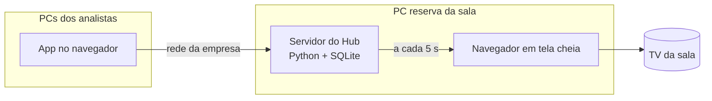

<p align="center">
  
</p>

<h1 align="center">Hub dos Analistas</h1>

<p align="center"><strong>Quem está na sala e o que cada um está fazendo, na TV, de relance.</strong><br>
Presença da equipe e quadro de demandas (A fazer · Fazendo · Concluído hoje), lançado por cada analista no próprio PC.</p>

<p align="center">
  
</p>

---

## O problema

Numa sala de analistas, ninguém sabe de relance quem está onde nem o que cada um está fazendo. Quem chega (o gerente, outro setor) precisa perguntar. As demandas ficam espalhadas entre e-mails, mensagens e a cabeça de cada um.

## A solução

Uma **TV na sala**, ligada num PC sempre ligado, mostra:

- **Presença:** Na sala, Em reunião, Pausa ou Fora da empresa, e **desde quando**. Cada pessoa marca a própria presença com um toque; nada é detectado automaticamente.
- **Quadro da equipe:** A fazer → Fazendo → Concluído hoje, com a cor e as iniciais de cada analista, as atrasadas em destaque e o prazo de cada demanda.
- **Demanda reservada:** um assunto sensível aparece só como "Demanda reservada". O título nunca sai do servidor para a TV.

Cada analista usa o **app** pelo navegador do próprio PC, sem instalar nada: marca a presença, lança demandas e as move entre as colunas. O botão **Tema** no cabeçalho alterna entre automático (segue o Windows), claro e escuro, e cada navegador lembra a sua escolha. Tudo fica no **histórico**, com quem fez e quando.

<p align="center">
  
</p>

## Como funciona



- **Regras do dia calculadas, não agendadas:** "Concluído hoje", "Fora da empresa" depois da meia-noite e "atrasada" são calculados das datas toda vez. Não há tarefa de meia-noite que possa falhar.
- **A TV nunca rola:** o que não cabe vira "+ N demandas". Se o servidor cair, a TV mantém a última tela e avisa "sem atualização desde HH:MM".
- Detalhes em [docs/arquitetura.md](docs/arquitetura.md).

## Instalação (PC reserva, sem administrador)

1. Python 3.12+ "só para mim" ([passo a passo](docs/instalacao.md)).
2. Baixe o projeto (**Code › Download ZIP**) e extraia numa pasta fixa.
3. Dois cliques em **`instalar.bat`**. Ele também faz o Hub abrir junto com o Windows.
4. Dois cliques em **`iniciar.bat`**. A TV abre em tela cheia.
5. Em outro PC, abra `http://NOME-DO-PC-RESERVA:8800`, cadastre a equipe em **Pessoas** e pronto.

Primeira vez na empresa? Comece pelo [teste de rede](docs/primeiro-uso.md).

### Quer só ver funcionando?

```powershell
$env:HUB_DADOS = "$env:TEMP\hub-demo"
.venv\Scripts\python -m tools.seed_demo
.venv\Scripts\python -m hub
```

Cria uma equipe e demandas **fictícias** numa pasta separada. O script se recusa a escrever sobre uma equipe de verdade.

## Documentação

| Documento | Para quem |
|---|---|
| [Instalação](docs/instalacao.md) | Quem vai montar o PC da sala |
| [Primeiro uso](docs/primeiro-uso.md) | O roteiro na empresa, começando pelo teste de rede |
| [Arquitetura](docs/arquitetura.md) | Quem vai manter o código |
| [Segurança e dados](docs/seguranca-e-dados.md) | TI e gestão: o que fica onde e quem vê o quê |
| [Limitações](docs/limitacoes.md) | Todos |
| [Roadmap](docs/roadmap.md) | As fases da v2: tema, PIN, gestor, TV em rotação, painéis, banco de horas, rotinas, Pombo |
| [Decisões técnicas](docs/decisoes.md) | Por que cada escolha foi feita |

## Para desenvolvedores

```bat
.venv\Scripts\python -m pip install -r requirements-dev.txt
.venv\Scripts\python -m pytest
```

Python 3.12+ · FastAPI · Jinja2 · SQLite (WAL) · JavaScript puro na TV · pytest. O design e o plano de construção estão em [docs/superpowers](docs/superpowers).

Projeto irmão: [Pombo](https://github.com/fishman2004/pombo), que envia os relatórios por e-mail e WhatsApp.

---

Feito por **Kayo Ibiapino**, analista de dados.
