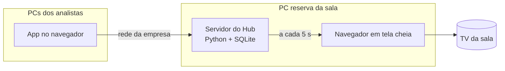

<p align="center">
  
</p>

<h1 align="center">Hub dos Analistas</h1>

<p align="center"><strong>Quem está na sala e o que cada um está fazendo, na TV, de relance.</strong><br>
Presença da equipe e quadro de demandas (A fazer · Fazendo · Concluído hoje), lançado por cada analista no próprio PC.</p>

<p align="center">
  
</p>

---

## O problema

Numa sala de analistas, ninguém sabe de relance quem está onde nem o que cada um está fazendo. Quem chega (o gerente, outro setor) precisa perguntar. As demandas ficam espalhadas entre e-mails, mensagens e a cabeça de cada um.

## A solução

Uma **TV na sala**, ligada num PC sempre ligado, mostra:

- **Presença:** Na sala, Em reunião, Pausa ou Fora da empresa, e **desde quando**. Cada pessoa marca a própria presença com um toque; nada é detectado automaticamente.
- **Quadro da equipe:** A fazer → Fazendo → Concluído hoje, com a cor e as iniciais de cada analista, as atrasadas em destaque e o prazo de cada demanda.
- **Demanda reservada:** um assunto sensível aparece só como "Demanda reservada". O título nunca sai do servidor para a TV, e no app só o dono, quem criou, o gestor e os administradores o veem.
- **Visão do gestor:** o dia da equipe numa tela só (presença, a fazer, fazendo, concluídas hoje e atrasadas por pessoa) e todas as demandas com filtros.
- **Banco de horas** (só no app, nunca na TV): o gestor importa o saldo que o RH envia e cada analista lança a entrada e a saída do dia, vendo na hora se está com horas extras ou negativas. Só a própria pessoa e o gestor veem.
- **Rotinas com horário:** PHD, transferências de pedidos, atualizações de positivações e comparativo de rotas ficam cadastrados na página **Rotinas**. No horário, o cartão aparece sozinho em A fazer do responsável e a TV toca um aviso com uma faixa na tela (a página Rotinas mostra os avisos de hoje e tem o botão **Testar aviso na TV agora**); depois do prazo ("até HH:MM"), ele fica atrasado. Nas transferências, cada pasta marca a sua e a rotina conclui sozinha quando todas marcarem; a atualização seguinte só libera depois disso.
- **Prioridades do mês:** a lista do início do mês (lançar a meta, confirmar a meta com o gerente, comissões até o dia 10, campanhas até o dia 15 e o que mais a equipe acrescentar). Fica na TV até tudo estar feito, com quem fez cada item; o que passou do prazo aparece como atrasado.
- **Envios do dia:** os relatórios que o [Pombo](https://github.com/fishman2004/pombo) de cada analista mandou hoje, lidos do histórico dele na pasta de rede: horário, envio, quem, canal e se saiu tudo (✓), se teve falha (⚠) ou se ainda está em andamento (⏳).

Cada analista usa o **app** pelo navegador do próprio PC, sem instalar nada. Entra com o próprio nome e um **PIN** de 4 a 6 números, marca a presença, lança demandas e as move entre as colunas. Em **Prioridades**, cria a lista do mês com um clique ("Criar lista padrão do mês"), acrescenta itens (com pasta e prazo, se quiser) e marca o que já foi feito. O botão **Tema** no cabeçalho alterna entre automático (segue o Windows), claro e escuro, e cada navegador lembra a sua escolha. Tudo fica no **histórico**, com quem fez e quando.

<p align="center">
  
</p>

## Como funciona



- **Regras do dia calculadas, não agendadas:** "Concluído hoje", "Fora da empresa" depois da meia-noite, "atrasada" e o cartão de cada rotina no horário dela são calculados toda vez. Não há tarefa agendada que possa falhar.
- **A TV passa de uma tela para a outra sozinha:** o Quadro, a tela **Prazos da semana** (quando há prazos), as **Prioridades do mês** (até tudo estar feito) e os **painéis de metas** (do mês, do dia e produtos foco), que o Hub calcula das planilhas de vendas guardadas na pasta dos painéis e mostra **só em porcentagem** ([paineis.md](docs/paineis.md)), e os **Envios do dia** do Pombo. Os tempos ficam em **Configurações**. Se houver demanda atrasada, um aviso fica no topo em todas as telas.
- **Descrição e arquivos nas demandas:** cada demanda tem um campo **Descrição** (para pedidos extensos; no quadro, o cartão mostra "📝 Descrição" e um clique abre o texto) e aceita arquivos (Excel, PDF...). Para mexer num arquivo, baixe, edite e use **Enviar nova versão**. A página **Demandas** acha qualquer demanda, inclusive as concluídas há tempo. Nada disso aparece na TV.
- **Calendário:** a página **Calendário** junta compromissos, feriados, ausências, prazos das demandas e das prioridades e rotinas. Os feriados saem da meta do dia dos painéis, das rotinas e do banco de horas. Na TV, a tela **Agenda** mostra hoje e os próximos dias.
- **Notas pessoais:** a página **Notas** é um bloco de notas só seu (nem o gestor vê), com arquivos, busca e "Transformar em demanda".
- **Modos da TV:** cada modo é uma receita da rotação (quais telas, ordem e tempos). **Início de mês** foca nas demandas e **Fim de mês** nos números, e os dois ligam sozinhos; há outros prontos (Reunião na sala sem som, Visita com os títulos escondidos...). Troque na página **TV da sala** e crie os seus em **Modos da TV**.
- **Prioridades por pasta e Assistente:** cada analista fica ligado às suas pastas (página **Pessoas**) e marca a prioridade do mês nas suas pastas; a página e a TV mostram quais pastas já fizeram, com quem marcou, e quais faltam. O papel **Assistente** (jovem aprendiz de meio período) pega demandas, tem jornada própria no banco de horas e não entra nas prioridades.
- **Exportar em PDF:** na página **TV da sala**, qualquer tela (ou todas) sai num PDF igual à TV, para mandar a alguém, com a mesma regra da TV (painéis só em %).
- **Pausar a TV:** um clique (ou Espaço) na própria TV pausa na tela atual. Pelo app, a página **TV da sala** pausa a TV da sala numa tela, troca de tela e retoma, ou abre qualquer tela só no seu PC. A pausa volta sozinha depois de 15 minutos.
- **A TV nunca rola:** uma coluna com mais demandas do que cabem passa as páginas sozinha, com um fade. Se o servidor cair, a TV mantém a última tela e avisa "sem atualização desde HH:MM".
- Detalhes em [docs/arquitetura.md](docs/arquitetura.md).

## Instalação (PC reserva, sem administrador)

1. Python 3.12+ "só para mim" ([passo a passo](docs/instalacao.md)).
2. Baixe o projeto (**Code › Download ZIP**) e extraia numa pasta fixa.
3. Dois cliques em **`instalar.bat`**. Ele também faz o Hub abrir junto com o Windows.
4. Dois cliques em **`iniciar.bat`**. A TV abre em tela cheia. Se ela não tocar o aviso das rotinas, [libere o som no Edge](docs/roteiros/fase-7-rotinas.md#som-na-tv).
5. Em outro PC, abra `http://NOME-DO-PC-RESERVA:8800` e cadastre a equipe em **Pessoas**. Quem criar o primeiro PIN vira administrador.
6. Usa o Pombo? Em **Configurações → Pombo**, informe a pasta do histórico (a mesma escolhida no Pombo de cada analista, em Configurações › Pasta do histórico). Os envios de hoje aparecem na página **Envios** e na TV.

Primeira vez na empresa? Comece pelo [teste de rede](docs/primeiro-uso.md).

### Quer só ver funcionando?

```powershell
$env:HUB_DADOS = "$env:TEMP\hub-demo"
.venv\Scripts\python -m tools.seed_demo
.venv\Scripts\python -m hub
```

Cria uma equipe, demandas, rotinas, prioridades do mês, planilhas de vendas e um histórico do Pombo **fictícios** numa pasta separada (PIN de todos: `1234`). O script se recusa a escrever sobre uma equipe de verdade.

## Documentação

| Documento | Para quem |
|---|---|
| [Instalação](docs/instalacao.md) | Quem vai montar o PC da sala |
| [Primeiro uso](docs/primeiro-uso.md) | O roteiro na empresa, começando pelo teste de rede |
| [Arquitetura](docs/arquitetura.md) | Quem vai manter o código |
| [Segurança e dados](docs/seguranca-e-dados.md) | TI e gestão: o que fica onde e quem vê o quê |
| [Painéis de dados](docs/paineis.md) | Quem exporta as planilhas: nomes, colunas e como o Hub calcula |
| [Limitações](docs/limitacoes.md) | Todos |
| [Roadmap](docs/roadmap.md) | As fases da v2 (tema, PIN, gestor, TV em rotação, painéis, banco de horas, rotinas, prioridades do mês, Pombo) e da v3 |
| [Plano da v3](docs/plano-v3.md) | As sugestões do gestor: pausa da TV, anexos, notas, calendário, modos da TV e PDF |
| [Decisões técnicas](docs/decisoes.md) | Por que cada escolha foi feita |

## Para desenvolvedores

```bat
.venv\Scripts\python -m pip install -r requirements-dev.txt
.venv\Scripts\python -m pytest
```

Python 3.12+ · FastAPI · Jinja2 · SQLite (WAL) · JavaScript puro na TV · pytest. O design e o plano de construção estão em [docs/superpowers](docs/superpowers).

Projeto irmão: [Pombo](https://github.com/fishman2004/pombo), que envia os relatórios por e-mail e WhatsApp. O Hub lê o histórico dele para a tela Envios do dia ([como](docs/arquitetura.md#envios-do-pombo-fase-9)).

---

Feito por **Kayo Ibiapino**, analista de dados.
