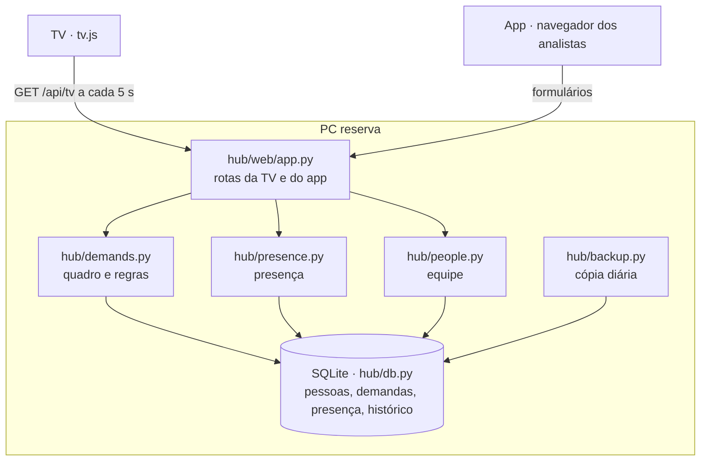

# Arquitetura

O Hub é **um servidor Python** no PC reserva da sala. Ele guarda tudo num SQLite e serve duas faces:

- **TV** (`/tv`): uma página que busca `/api/tv` a cada 5 segundos e desenha a tela com JavaScript puro.
- **App do analista** (`/`): páginas HTML com formulários, usadas pelo navegador de cada PC.

## Decisões que moldam o código

- **Regras do dia calculadas, não agendadas.** Nenhuma tarefa roda à meia-noite:
  - "Concluído hoje" = concluídas com `done_at` na data de hoje;
  - presença marcada antes de hoje vale como "Fora da empresa" desde 00:00 (`presence.effective`);
  - "atrasada" = prazo antes de hoje e fora de Concluído (`demands.is_overdue`).
  Se o PC passou a noite desligado, nada fica para trás.
- **Demanda reservada é mascarada no servidor** (`demands.tv_card`): a resposta da TV não contém o título, a pasta nem quem pediu. Não é só a tela escondendo.
- **Histórico de tudo** (`db.log_event`): cada mudança grava quem, quando e o quê. Ele alimenta a tela de histórico e as próximas versões (banco de horas, visão do gerente).
- **SQLite em modo WAL**, uma conexão por operação, com espera de até 5 s: dois PCs mexendo no mesmo cartão ao mesmo tempo não dão erro, e vale a última mudança (as duas ficam no histórico).
- **A TV nunca rola:** `tv.js` acrescenta cartões enquanto cabem e troca o que sobra por "+ N demandas". O tamanho das letras acompanha a largura da tela (`html { font-size: 100vw / 120 }`), então funciona em qualquer TV.
- **Tema do app no navegador, não no servidor** (`static/tema.js`): cada pessoa escolhe automático, claro ou escuro, e a escolha fica no `localStorage` daquele navegador. As cores são variáveis CSS em `app.css`; `data-tema` no `<html>` força claro ou escuro, e sem ele vale o modo do Windows. O script carrega no `<head>` para a página já nascer no tema certo. A TV usa `tv.css` e não carrega esse script, então não muda com a escolha de ninguém.
- **Sem senha na versão 1:** cada pessoa escolhe o próprio nome uma vez (cookie no navegador). Formulários vindos de outro site são recusados (mesma origem).

## Onde está cada coisa

| Arquivo | Responsabilidade |
|---|---|
| `hub/__main__.py` | Sobe o servidor (porta 8800, uma cópia só), cópia diária, abre a TV em quiosque |
| `hub/db.py` | Banco, esquema e histórico |
| `hub/people.py` | Equipe: nome, iniciais, cor |
| `hub/demands.py` | Demandas, quadro, ordem, atrasadas, cartão da TV |
| `hub/presence.py` | Presença e a virada do dia |
| `hub/backup.py` | Cópia de segurança diária (14 dias) |
| `hub/winsys.py` | Abrir com o Windows, não dormir, TV em tela cheia |
| `hub/web/` | Rotas, páginas, o JavaScript da TV e o do tema do app (`static/tema.js`) |
| `tools/` | Teste de rede e dados de demonstração |
| `tests/` | Testes automáticos (pytest) |
