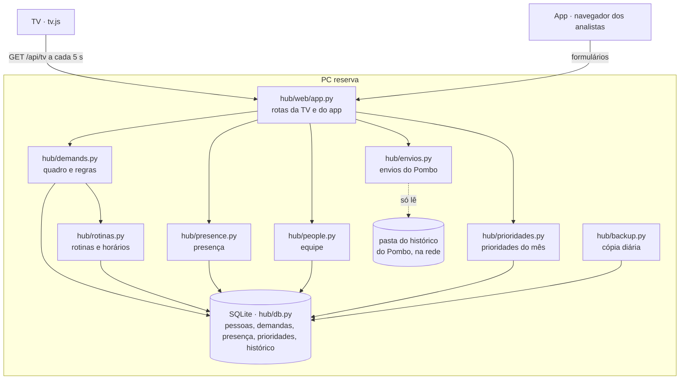

# Arquitetura

O Hub é **um servidor Python** no PC reserva da sala. Ele guarda tudo num SQLite e serve duas faces:

- **TV** (`/tv`): uma página que busca `/api/tv` a cada 5 segundos e desenha a tela com JavaScript puro.
- **App do analista** (`/`): páginas HTML com formulários, usadas pelo navegador de cada PC.

## Decisões que moldam o código

- **Regras do dia calculadas, não agendadas.** Nenhuma tarefa roda à meia-noite:
  - "Concluído hoje" = concluídas com `done_at` na data de hoje;
  - presença marcada antes de hoje vale como "Fora da empresa" desde 00:00 (`presence.effective`);
  - "atrasada" = prazo antes de hoje e fora de Concluído (`demands.is_overdue`);
  - o cartão de cada rotina aparece quando chega o horário dela (`demands.board`, fase 7).
  Se o PC passou a noite desligado, nada fica para trás.
- **Demanda reservada é mascarada no servidor** (`demands.tv_card`): a resposta da TV não contém o título, a pasta nem quem pediu. Não é só a tela escondendo. No app, `demands.can_see` decide quem vê o título (o dono, quem criou, o gestor e os administradores); para os demais, o quadro, o histórico e as rotas da demanda mascaram ou recusam (403).
- **Histórico de tudo** (`db.log_event`): cada mudança grava quem, quando e o quê. Ele alimenta a tela de histórico e a visão do gestor e as próximas versões (banco de horas).
- **SQLite em modo WAL**, uma conexão por operação, com espera de até 5 s: dois PCs mexendo no mesmo cartão ao mesmo tempo não dão erro, e vale a última mudança (as duas ficam no histórico).
- **A TV nunca rola:** cada coluna do Quadro é dividida em páginas que cabem (medindo de verdade no navegador) e passa as páginas com um fade no tempo configurado. Nas outras telas, o que não cabe vira "+ N demandas". O tamanho das letras acompanha a largura da tela (`html { font-size: 100vw / 120 }`), então funciona em qualquer TV.
- **TV em rotação, com telas registráveis** (fase 4): `hub/telas.py` lista as telas (`SCREENS`), cada uma com um tempo padrão e uma função que monta os dados dela, ou devolve `None` quando não há o que mostrar (aí ela sai da rotação). O `/api/tv` manda as telas que entram agora, com o tempo de cada uma. No navegador, `tv.js` cuida do que é comum (busca a cada 5 s, presença, relógio, aviso de atrasadas, "sem atualização", rotação e indicador) e cada tela é um arquivo em `static/tv-telas/` que chama `HubTV.registrar(id, { desenhar, aoMostrar })`. As telas ficam empilhadas na mesma área; só a ativa aparece, com um fade, sem recarregar a página.

  **Para plugar uma tela nova:** (1) escreva a função de dados e registre em `SCREENS`; (2) crie `static/tv-telas/<id>.js`; (3) acrescente `<section class="tela" data-tela="<id>">` e o `<script>` em `tv.html`. O teste `test_every_registered_screen_has_a_drawing` confere que as três partes existem. Os tempos e o liga/desliga aparecem sozinhos em Configurações.
- **Rotinas calculadas** (fase 7, `hub/rotinas.py` e `demands.board`): o cadastro fica na tabela `routines` (dias da semana, horário, prazo, responsável, pastas e as rotinas que ela espera). A cada montagem do quadro, `demands.board` junta às demandas um cartão para cada rotina que vale hoje e cujo horário já chegou (`id` vazio, endereço `rotina-<número>-<dia>`), com o horário, o prazo, as pastas marcadas e a espera (`RoutineInfo`). Na primeira ação sobre o cartão (mover, editar, excluir ou marcar pasta), `demands._resolve` cria a demanda de verdade, com `routine_id` e `routine_day` (índice único: uma por rotina e por dia), dentro da mesma gravação da ação. As pastas marcadas ficam em `routine_folders`, com quem marcou. `move_demand` recusa começar ou concluir uma rotina que ainda espera outra, e concluir à mão com pasta faltando; `toggle_folder` leva o cartão para Fazendo e Concluído hoje sozinho. Passou do prazo de hoje, o cartão conta como atrasado (`is_overdue`).
- **Aviso sonoro na TV:** o `/api/tv` manda em `avisos` as rotinas de hoje (`rotinas.tv_alerts`: chave `rotina-<número>-<dia>`, horário, nome e prazo). O `tv.js` confere a cada segundo, com o relógio do servidor; quando um horário chega, toca `static/aviso.wav` uma vez e mostra a faixa `#aviso-rotina` por 20 s por cima de qualquer tela. As chaves já tocadas ficam na memória e no `localStorage` (com try/catch): recarregar não repete, e um horário que passou há mais de 10 min não toca. O Edge abre com `--autoplay-policy=no-user-gesture-required` (`winsys.open_tv`) para o som tocar sem clique.
- **Tema do app no navegador, não no servidor** (`static/tema.js`): cada pessoa escolhe automático, claro ou escuro, e a escolha fica no `localStorage` daquele navegador. As cores são variáveis CSS em `app.css`; `data-tema` no `<html>` força claro ou escuro, e sem ele vale o modo do Windows. O script carrega no `<head>` para a página já nascer no tema certo. A TV usa `tv.css` e não carrega esse script, então não muda com a escolha de ninguém.
- **Entrar com nome + PIN** (`hub/access.py`, fase 2): o PIN é guardado só como resumo PBKDF2 com sal próprio. Ao acertar, o servidor cria uma sessão (tabela `sessions`, com o resumo do token) que acaba à meia-noite; o cookie `hub_sessao` só carrega o token. Cinco PINs errados seguidos bloqueiam aquele nome por 5 minutos. A TV e o `/api/tv` continuam sem login e não leem nada disso.
- **Papéis:** cada pessoa é `analista` ou `gestor` (coluna `role`) e pode ter a marcação `is_admin`. Só administrador abre Pessoas, muda papéis e redefine PIN. Sempre sobra pelo menos um administrador; sem nenhum (instalação nova ou logo depois de atualizar da v1), quem cria o primeiro PIN vira administrador.
- **Migrações automáticas** (`db.MIGRATIONS`): cada mudança no banco depois da v1 tem um número, guardado no `PRAGMA user_version`. Ao iniciar, o Hub copia o banco para `copias/antes-da-vN-....db` e aplica as que faltam, cada uma inteira ou nada. Elas só acrescentam colunas e tabelas.
- **Painéis de dados** (fase 5, `hub/paineis.py` e `hub/planilhas.py`): o Hub lê as planilhas da pasta dos painéis (CSV ou XLSX), calcula meta x realizado por pasta e entrega à TV **só porcentagens**. Cada arquivo é relido apenas quando muda (data e tamanho), numa linha separada, para a TV nunca esperar a leitura da 8081. Arquivo ausente ou quebrado tira da rotação só as telas que dependem dele. Contratos e regras em [paineis.md](paineis.md).
- **Banco de horas** (fase 6, `hub/horas.py`): tabelas `hours_balance` (saldo base de cada pessoa, até uma data) e `hours_entries` (entrada e saída de cada dia, um dia por pessoa). O saldo é calculado, não guardado: saldo base + (horas do dia − jornada) de cada dia lançado depois da data do saldo base. Só a própria pessoa e o gestor veem (`horas.can_see`); as linhas do histórico sobre horas seguem a mesma regra. A TV não importa o módulo, e um teste confere que o `/api/tv` não executa nenhum comando nessas tabelas.
- **Prioridades do mês** (fase 8, `hub/prioridades.py`, tabela `priorities` da migração 6): cada item guarda o mês (`AAAA-MM`), o título, a pasta e o prazo (dia do mês) opcionais, quem criou, quem fez e quando. O mês vem da data, sem tarefa agendada: no dia 1º a lista nova começa vazia, e a dos meses anteriores só abre para consulta (o servidor recusa mudar). "Atrasada" também é calculada (`is_late`): em aberto e já passou do dia do prazo. A lista padrão (`DEFAULT_LIST`) só entra num mês sem nenhum item, travando a escrita antes de conferir, então dois cliques não criam duas listas. Remover só marca `deleted = 1`. A tela `prioridades` da TV (`tv_prioridades`) devolve `None` sem lista ou com tudo feito, e manda só o título, a pasta, o prazo, se está atrasada e as iniciais e a cor de quem fez (sem nomes nem horários). No navegador, `tv-telas/prioridades.js` usa uma coluna quando tudo cabe, duas quando não, e passa páginas com fade se ainda não couber.
- **Envios do Pombo** (fase 9, `hub/envios.py`): o Hub lê o histórico CSV que o Pombo de cada analista grava na pasta de rede e mostra os envios de hoje na tela **Envios do dia** e na página **Envios**. Só lê, nunca escreve. Detalhes logo abaixo.
- Formulários vindos de outro site são recusados (mesma origem).

## Envios do Pombo (fase 9)

O [Pombo](https://github.com/fishman2004/pombo) grava cada envio em `<pasta do histórico>/<analista>/<AAAA-MM>.csv` (um arquivo por analista por mês, UTF-8 com BOM, separado por vírgula), com as colunas `data_hora, analista, envio, horario_agendado, canal, destinatario, arquivos, status, detalhe, envio_id, destinatario_id`. Um administrador informa essa pasta em **Configurações → Pombo** (em branco, a integração fica desligada; a configuração fica na tabela `settings`, sem migração).

**A leitura segue a do Pombo** (`pombo/history.py`): pula o cabeçalho, ignora linha estragada (data que não é `AAAA-MM-DD HH:MM:SS` ou menos de 10 colunas, como uma linha salva pelo Excel ou cortada numa queda de energia), aceita arquivo antigo sem a última coluna e ignora colunas novas no fim. O Hub conta as linhas ignoradas e mostra na página Envios.

**Rodada** é um envio num horário: as linhas com o mesmo `envio_id` e o mesmo `horario_agendado`, de um analista (a pasta dele separa, porque dois Pombos podem ter o mesmo `envio_id`). Entram as rodadas com horário de hoje (`AAAA-MM-DD HH:MM`, ou `manual AAAA-MM-DD HH:MM:SS` para um "Enviar agora"), em ordem de horário. Cada destinatário é reconhecido como no Pombo (`engine._matches`): pelo canal e pelo `destinatario_id` ou, nas linhas antigas sem ele, pelo nome.

| Destinatário | Quando |
|---|---|
| enviado | alguma linha `enviado` ou `demonstracao` (uma falha seguida de sucesso é sucesso) |
| tentando de novo | falhou menos de 4 vezes e a última falha tem menos de 10 min (o Pombo tenta a cada 5 min, até 4 vezes) |
| falhou | falhou 4 vezes, ou a última falha passou de 10 min sem nova tentativa |
| esperando | só linhas `esperando`: o canal (WhatsApp) está fora do ar e o Pombo envia quando voltar |

| Situação da rodada | Grupo | Na TV | Quando |
|---|---|---|---|
| enviado | ok | ✓ tudo enviado | todos os destinatários enviados |
| manual | ok | ✓ enviado às HH:MM (manual) | rodada sem envio, cumprida por um "Enviar agora" depois do horário (como no Pombo) |
| parcial / falhou | com falha | ⚠ N falhas | algum destinatário falhou de vez |
| tentando | em andamento | ↻ tentando de novo | sem falha definitiva e algum destinatário com nova tentativa a caminho |
| conexão | em andamento | ⏳ esperando conexão | algum destinatário esperando o canal |
| esperando | em andamento | ⏳ esperando atualização | só a linha da rodada inteira `esperando`: o arquivo ainda não foi atualizado hoje |
| desistiu | com falha | ⚠ não atualizado | o Pombo esperou 1 h pelo arquivo e não enviou |
| perdido | com falha | ⚠ perdido | o Pombo estava fechado no horário |

Como na tela Hoje do Pombo, o que já foi enviado ou tentado vale mais que as linhas da rodada inteira (esperando, desistiu, perdido).

**Leitura em segundo plano, com cache:** a pasta fica na rede e pode estar lenta ou fora do ar. Por isso tudo, até listar a pasta, roda numa linha separada (`EnviosStore`), no máximo a cada 5 s; a TV recebe a última leitura pronta e nunca espera. Cada arquivo só é relido quando muda (data e tamanho). Arquivo que não abre (aberto no Excel) ou pasta fora do ar: o Hub segue com a última leitura boa, avisa na TV e na página, e registra no `hub.log` uma vez (não a cada 5 s). A página Envios espera até 8 s por uma leitura nova.

**O que vai para a TV** (`tv_envios`): horário, nome do envio, analista (nome, iniciais e cor do cadastro do Hub, quando o nome ou a pasta batem; senão o nome que o Pombo gravou), canal, situação e a contagem "N de M enviados". Destinatários, detalhes dos erros e nomes de arquivo ficam só na página Envios. Sem pasta configurada ou sem envio hoje, a tela sai da rotação.

## Onde está cada coisa

| Arquivo | Responsabilidade |
|---|---|
| `hub/__main__.py` | Sobe o servidor (porta 8800, uma cópia só), cópia diária, abre a TV em quiosque |
| `hub/db.py` | Banco, esquema, migrações e histórico |
| `hub/access.py` | PIN, bloqueio, sessões do dia, papéis e administradores |
| `hub/gestor.py` | Visão do gestor: resumo do dia por pessoa e filtros das demandas |
| `hub/telas.py` | Telas da TV, rotação e as configurações (tempos) |
| `hub/paineis.py` | Painéis de dados: pasta, os arquivos, cálculo das metas, cache e o que vai para a TV |
| `hub/horas.py` | Banco de horas: saldo base, lançamentos, saldo calculado, importação da planilha do RH e exportação |
| `hub/planilhas.py` | Leitura de CSV e XLSX (cabeçalho sem acento, número e data em formato brasileiro) |
| `hub/prioridades.py` | Prioridades do mês: a lista, quem fez, prazo e atrasadas, a lista padrão e o que vai para a TV |
| `hub/envios.py` | Envios do Pombo: pasta do histórico, leitura igual à do Pombo, situação de cada rodada, cache em segundo plano e o que vai para a TV |
| `hub/people.py` | Equipe: nome, iniciais, cor |
| `hub/demands.py` | Demandas, quadro, ordem, atrasadas, cartão da TV, e o cartão de cada rotina (calculado, vira demanda na primeira ação, pastas e espera) |
| `hub/rotinas.py` | Cadastro das rotinas, quando cada uma vale, as rotinas sugeridas e os avisos da TV |
| `hub/presence.py` | Presença e a virada do dia |
| `hub/backup.py` | Cópia de segurança diária (14 dias) |
| `hub/winsys.py` | Abrir com o Windows, não dormir, TV em tela cheia |
| `hub/web/` | Rotas, páginas, o JavaScript da TV (`static/tv.js` e uma tela por arquivo em `static/tv-telas/`) e o do tema do app (`static/tema.js`) |
| `tools/` | Teste de rede, dados de demonstração (inclusive um histórico fictício do Pombo), as planilhas de exemplo dos painéis (`tools/exemplos/`, geradas por `tools/gerar_exemplos.py`) e o gerador do som do aviso (`tools/gerar_som.py`, que grava `hub/web/static/aviso.wav`) |
| `tests/` | Testes automáticos (pytest) |
