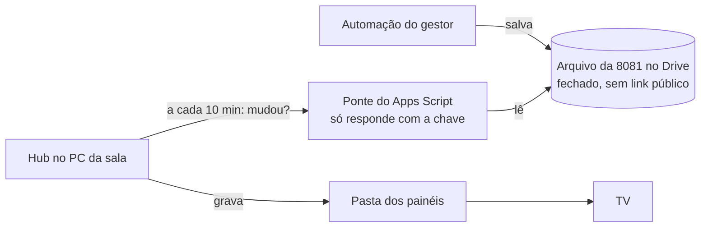

# Base 8081 automática do Google Drive (fase 22)

O gestor tem uma automação no Google Sheets que salva a **(DADOS) - 8081 - Vendas** no Google Drive com frequência. Com isto ligado, o Hub do PC da sala baixa esse arquivo sozinho, de tempos em tempos, e a TV mostra os números novos sem ninguém copiar arquivo.

## Como funciona

1. A **ponte** é um script pequeno do Google ([`tools/drive/ponte-8081.gs`](../tools/drive/ponte-8081.gs)) publicado pela conta Google que já abre o arquivo. Ela só entrega o arquivo para quem manda a **chave** certa.
2. O Hub pergunta à ponte, a cada 10 minutos (dá para mudar), se o arquivo mudou. Se não mudou, a resposta é só "igual" e nada é baixado.
3. Se mudou, o Hub baixa, **confere** se tem as colunas da 8081 e só então troca o arquivo na pasta dos painéis. Download pela metade ou planilha errada nunca chega à TV: a TV continua com o arquivo anterior e a página Painéis mostra o problema.
4. A hora do arquivo é a hora em que a automação gerou a 8081 no Drive, então o "atualizado às" da TV e o aviso de **Dados desatualizados** continuam certos.

Nada precisa de administrador do Windows: o download é do próprio Hub, sem programa novo no PC da sala.

## Por que uma ponte com chave (e não outro jeito)

| Jeito | Por que não |
|---|---|
| Google Drive para computador sincronizando a pasta | Precisa de administrador do Windows para instalar no PC da sala |
| Link "qualquer pessoa com o link" | Qualquer pessoa que achar o link baixa as vendas da empresa, e não dá para saber quem baixou |
| API oficial do Drive com conta de serviço | Precisa de projeto no Google Cloud e de um arquivo de credencial; empresas costumam bloquear a criação dessas chaves |

A ponte deixa o arquivo fechado no Drive, a chave é longa e aleatória (43 letras e números), fica só no `hub.db` do PC da sala e nas Propriedades do script, e dá para trocar a qualquer hora (gerar outra no Hub e colar na ponte).

## Passo a passo (uma vez só)

**No Google (com a conta que abre o arquivo da 8081: a do gestor, ou a sua se o arquivo estiver compartilhado com você):**

1. Abra [script.google.com](https://script.google.com) → **Novo projeto**. Dê um nome, por exemplo "Ponte do Hub".
2. Apague o que vier no editor e cole todo o conteúdo de [`tools/drive/ponte-8081.gs`](../tools/drive/ponte-8081.gs). Salve (Ctrl+S).
3. Clique na **engrenagem (Configurações do projeto)** → **Propriedades do script** → **Adicionar propriedade**:
   - `ARQUIVO_ID`: o id do arquivo. No link `https://drive.google.com/file/d/`**`1AbC...xyz`**`/view`, é o trecho entre `/d/` e `/view`.
   - Se a automação cria **um arquivo novo a cada vez** (o link muda), use `PASTA_ID` no lugar: o id da pasta (no link `.../folders/`**`id`**). A ponte pega o arquivo mais novo da pasta cujo nome começa com `(DADOS) - 8081`.
   - `CHAVE_HUB`: fica para o passo 7.
4. **Implantar → Nova implantação** → engrenagem ao lado de "Selecione o tipo" → **App da Web**.
   - Executar como: **Eu**.
   - Quem pode acessar: **Qualquer pessoa**. (Quem não tem a chave só recebe "chave errada"; o arquivo não sai.)
5. **Implantar** → **Autorizar acesso** → escolha a conta → em "O Google não verificou este app", **Avançado → Acessar Ponte do Hub (não seguro)** → **Permitir**. É o aviso normal de um script seu.
6. Copie o **URL do app da Web** (começa com `https://script.google.com/macros/s/` e termina com `/exec`).

**No Hub (como administrador):**

7. Em **Configurações → Base 8081 do Google Drive**, cole o endereço, deixe marcado **Gerar chave nova** e clique em **Salvar**. A chave aparece **uma vez** na mensagem verde: copie e cole na propriedade `CHAVE_HUB` da ponte (passo 3). Não precisa implantar de novo para mudar uma propriedade.
8. Abra **Painéis** e clique em **Baixar agora**. Deve aparecer "Arquivo novo baixado" e a planilha de vendas como **Lida**.

Pronto: daí em diante o Hub verifica sozinho. Se a conta do script trocar a senha ou sair da empresa, a ponte para; refaça os passos 1 a 7 com outra conta.

## Quando algo dá errado

A página **Painéis**, no quadro **Base 8081 do Google Drive**, mostra a última verificação, o último arquivo baixado e o último problema:

| Mensagem | O que fazer |
|---|---|
| A ponte recusou a chave | A `CHAVE_HUB` do script tem de ser igual à do Hub. Gere outra no Hub e cole na ponte |
| Sem conexão com o Google | O PC da sala não está acessando a internet (ou o proxy da empresa bloqueia `script.google.com`): fale com a TI |
| Veio uma página em vez dos dados | O endereço não termina com `/exec` ou a implantação não está como "Qualquer pessoa" |
| O Google respondeu com erro 4xx/5xx | Implantação apagada ou endereço errado; se for 5xx, o Google está com problema e o Hub tenta de novo sozinho |
| Faltam as colunas | O arquivo do Drive mudou de formato: a TV continua com o anterior até ele voltar a ter as colunas da 8081 |

Se o Google estiver fora do ar ou a internet cair, a TV continua com o último arquivo baixado; o aviso de **Dados desatualizados** aparece depois das horas definidas em Configurações.

Para **desligar**, apague o endereço em Configurações e salve (a chave é apagada junto). A 8081 volta a vir só pela pasta dos painéis ou pelo envio na página Painéis, como antes.
