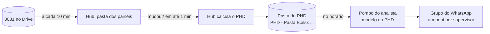

# PHD automático (fase 24)

O **PHD** (positivação representante dia) mostra, por vendedor, quantos clientes ele positivou em cada
dia do mês. Até aqui, o analista mantinha a planilha, filtrava por supervisor, tirava o print e escrevia o
texto do grupo. Agora:

1. A **8081** chega sozinha do Drive ([drive-8081.md](drive-8081.md)) ou pela pasta dos painéis.
2. Quando ela muda, o Hub calcula o PHD e grava **uma planilha por pasta** (`PHD - Pasta A.xlsx` ...
   `PHD - Televendas.xlsx`) na **pasta do PHD**.
3. O **Pombo** de cada analista lê a planilha da sua pasta com o **modelo do PHD** e, no horário, manda no
   grupo um print com legenda por supervisor ([Pombo: mensagens com print](https://github.com/fishman2004/pombo/blob/main/docs/mensagens-com-print.md)).

## O cálculo

- **Positivação do dia** = clientes **distintos** que o vendedor atendeu naquele dia. O mesmo cliente em
  vários pedidos ou produtos no mesmo dia conta 1.
- Todas as posições contam (L, B, M e F); cancelado nem vem na extração.
- O mês é o da venda mais recente da 8081.
- A **pasta** do vendedor é a do supervisor ("B-BJ (NOME)" é da B; "P-TELEVENDAS (NOME)" é o Televendas),
  igual aos painéis. Vendedor sem pasta fica de fora.
- **MÉDIA** (coluna AK) = positivações do mês ÷ dias de venda (seg a sáb, sem feriados) **até ontem**:
  hoje ainda está acontecendo.
- **ÁREA** vem do quadro "Área de cada supervisor" em Painéis (ex.: `B-BJ = CAMPINA GRANDE`). Sem linha, a
  área é o código do supervisor.

## A planilha

O mesmo desenho do PHD dos analistas (e do modelo do PHD no Pombo):

| Onde | O quê |
|---|---|
| Linhas 2 e 3 | Título, pasta, mês e "vendas até" |
| Linhas 5 a 11 | Quadro por supervisor (até 4 supervisores) com o total de cada dia |
| Linha 13 / 14 | Dia da semana / dia do mês, de F (dia 1) a AJ (dia 31) |
| Linha 15 | ÁREA, ID, VENDEDOR, SUPERVISOR, o total de cada dia e MÉDIA (AK) |
| Linha 16 em diante | Um vendedor por linha, por supervisor |

Cores do PHD (formatação condicional): 5 ou mais verde, 1 a 4 laranja, zero rosa.

A hora do arquivo é a hora da 8081 que o gerou. Se a 8081 parar de chegar, o Pombo vê um PHD velho e
**não envia** número de ontem como se fosse de hoje: espera e avisa o analista.

## Ligar (uma vez)

1. **Painéis → PHD automático → Configurar** (administrador):
   - **Pasta onde gravar**: a pasta de rede que os analistas abrem (a mesma do histórico do Pombo serve).
   - **Área de cada supervisor**: uma linha por supervisor, `B-BJ = CAMPINA GRANDE`.
   - **Salvar e gerar**. Os arquivos aparecem na lista, com link para baixar e conferir.
2. **No Pombo de cada analista**: Envios › Novo envio › Print da planilha › **Preencher com o modelo do PHD**,
   e em **Planilha** o caminho do PHD da sua pasta (ex.: `\\servidor\Analistas\PHD\PHD - Pasta B.xlsx`).
   Grupo, dias e horário (ex.: seg a sex, 08:45). **Pré-visualizar** e **Enviar teste só para mim**.

## Privacidade

A planilha do PHD tem nomes de vendedores. Ela vai só para a pasta escolhida e para o link de download da
página Painéis (só para quem entrou no Hub). **Nunca vai para a TV**, que continua só com porcentagens.
