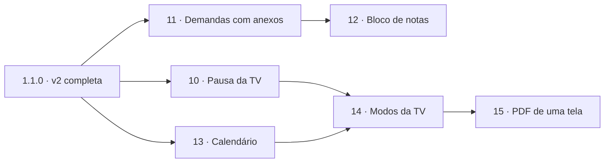

# Plano do Hub dos Analistas · v3 (sugestões do gestor)

> Repositório: https://github.com/fishman2004/hub-analistas
> Pedido do Kayo (analista de dados, iniciante em programação), com as sugestões do gestor, em 21/10/2026. Explique o que fizer em linguagem simples.
> **Situação:** aprovado pelo Kayo em 21/10/2026, com os padrões sugeridos nas perguntas do fim.

## Situação atual

O `main` está na **versão 1.1.0**: v1 + as fases 1 a 9 da v2 (tema, PIN e papéis, visão do gestor, TV em rotação, painéis de dados, banco de horas, rotinas com aviso, prioridades do mês, envios do Pombo) e o quadro "Avisos de hoje na TV". O banco está na **migração 6** (`db.MIGRATIONS`). A TV tem 8 telas registradas em `hub/telas.py` (`SCREENS`): Quadro, Prazos da semana, Prioridades do mês, Metas do mês, Metas do dia, Produtos foco, Fornecedores e Envios do dia.

Antes de qualquer código, leia: `README.md`, `docs/arquitetura.md`, `docs/decisoes.md`, `docs/limitacoes.md`, `docs/seguranca-e-dados.md`, `docs/roadmap.md`, `docs/paineis.md` e este plano. Rode `pytest` e confirme que tudo passa.

O que já existe e este plano aproveita:

- **Editar demanda já existe** (`/demandas/{ref}`, `demands.update_demand`): título, dono, pasta, pedido por, prazo e reservada. Hoje qualquer pessoa que vê a demanda pode editar, e o histórico só guarda o título novo. O pedido do gestor acrescenta o que falta: **detalhes** e **arquivos**.
- **A TV já é feita de telas plugáveis** com tempo e liga/desliga em Configurações (tabela `settings`). Pausa, modos e PDF se apoiam nisso.
- **`python-multipart` já é dependência** (envio de planilha na página Painéis), então receber arquivos não pede nada novo.

## Regras que valem para todas as fases (as mesmas da v2)

1. **Nada que exija administrador do Windows.** Atualizar continua sendo extrair o ZIP por cima e rodar `instalar.bat`.
2. **Dados de produção são sagrados.** Toda mudança no banco é uma migração versionada e automática (`db.MIGRATIONS` + `PRAGMA user_version`), com cópia antes, que só acrescenta. Teste a migração a partir de um banco da 1.1.0.
3. **Regras da TV:** nunca rola, mantém a última tela se o servidor cair, sem CDN nem internet, **título de demanda reservada nunca sai do servidor**, **painéis só com gráficos e porcentagens**, **banco de horas nunca**. Agora também: **anexos, notas pessoais e compromissos particulares nunca vão para a TV** (nem nome de arquivo, nem contagem), com teste que rastreia o SQL do `/api/tv`, como o das horas.
4. **Dependência nova só com justificativa** em `docs/decisoes.md` e sem compilar. **Este plano não precisa de nenhuma** (PDF pelo próprio Edge, feriados calculados em Python puro, arquivos com a biblioteca padrão).
5. **Testes primeiro (pytest)** para regra de negócio, permissões, migrações e o que a TV recebe.
6. **Português do Brasil**, e o repositório é público: **nunca nomes reais** em código, testes, docs, commits ou PRs (dados fictícios: "Kayo", "Bianca", "Ana Souza"...).
7. **Uma fase por vez, um branch e um PR por fase**, terminando com testes passando, docs atualizadas (`roadmap.md`, `arquitetura.md`, `decisoes.md`, `limitacoes.md`, `seguranca-e-dados.md` e o README quando mudar o uso) e um **roteiro de teste manual** em `docs/roteiros/fase-N-*.md`.
8. **Branch por fase** com o nome `hub/v3-faseN-nome`, autor dos commits o Kayo.
9. **Perguntas em aberto:** cada fase começa conferindo as respostas do Kayo. Sem resposta, vale o **padrão sugerido** (marcado "Padrão:"), anotado em `decisoes.md` como "Em aberto (o Kayo confirma)".
10. **Versão:** cada fase sobe a versão menor (`1.2.0`, `1.3.0`...) em `pyproject.toml` e `hub/__init__.py`, para a TV recarregar CSS e JS novos.

## Ordem das fases

A numeração continua a da v2 (os roteiros já vão até a fase 9).

| Fase | Entrega | Migração | Por que nessa ordem |
|---|---|---|---|
| 10 | **Pausa da TV** (na própria TV e pelo PC) e "ver uma tela no meu PC" | nenhuma (`settings`) | Pequena, muito visível, e cria o "controle remoto" da TV que os modos usam |
| 11 | **Demandas com detalhes e anexos** (Excel, PDF...) + busca de demandas antigas | 7 | Segundo pedido do gestor; cria o módulo de anexos que as notas reaproveitam |
| 12 | **Bloco de notas pessoal** com anexos | 8 | Reaproveita os anexos da fase 11 |
| 13 | **Calendário** (compromissos, feriados, prazos e rotinas num lugar) + tela **Agenda** na TV | 9 | Os feriados alimentam os modos automáticos ("primeiros dias úteis") |
| 14 | **Modos da TV** (Início de mês, Fim de mês e outros) e criar modos | 10 | Usa a pausa, a Agenda e os feriados |
| 15 | **Exportar uma tela da TV em PDF** | nenhuma | Fica por último para já cobrir todas as telas, inclusive a Agenda |

O Kayo pode trocar a ordem: as fases 10, 14 e 15 só mexem na TV; 11, 12 e 13 só no app (a 13 traz uma tela nova). A única dependência dura é **12 depois da 11** (anexos).

**Fase 0 (antes da 10, no mesmo PR da fase 10):** copiar este plano para `docs/plano-v3.md` (sem nomes reais) e acrescentar as fases 10 a 15 em `docs/roadmap.md` como "Planejada".



---

## Fase 10 · Pausa da TV

**Pedido do gestor:** "botão de pause no hub da TV, se precisamos analisar algo em nossos PCs ou deixar pausado na própria TV."

### Como funciona para o usuário

São três jeitos, para os dois casos do pedido:

1. **Na própria TV** (com o mouse ou o teclado do PC da sala): um clique em qualquer lugar da TV, ou a tecla **Espaço**, pausa na tela que está aparecendo. Aparece no topo um selo **"⏸ Pausada"** e o tempo que falta para voltar sozinha. As setas **← →** trocam de tela enquanto está pausada; **↑ ↓** passam as páginas das colunas do Quadro. Outro clique (ou Espaço) volta à rotação.
2. **Pausar a TV da sala pelo meu PC:** uma página nova no app, **TV da sala** (link no menu, ao lado de "Ver a TV"), mostra qual tela está na TV agora e as telas que estão na rotação. Botões: **Pausar nesta tela**, **Fixar na tela…** (escolhe uma da lista), **◀ Anterior / Próxima ▶**, **Página seguinte** (Quadro) e **Voltar à rotação**. A TV obedece em até 5 segundos. O selo na TV mostra "⏸ Pausada por KI" (as iniciais de quem pausou).
3. **Ver uma tela no meu PC, sem mexer na TV da sala:** na mesma página, cada tela tem **Abrir no meu PC**: abre `/tv?tela=metas-mes&fixa=1` numa aba, já pausada naquela tela, com as setas para navegar. Isso não muda nada na sala. É o caso "analisar algo no nosso PC".

**Volta sozinha:** toda pausa tem prazo, para a TV nunca ficar esquecida parada. Padrão de 15 minutos, com opções de 5, 15, 30 e 60 min e "até o fim do dia" na página TV da sala. A pausa local (clique na TV) usa o mesmo padrão.

**Enquanto pausada:** os dados continuam atualizando a cada 5 s (o número muda, a tela não), a presença e o relógio continuam, e o **aviso sonoro das rotinas toca normalmente** por cima.

### Quem pode usar

| Ação | Quem |
|---|---|
| Pausar com clique/tecla na própria TV | Quem estiver no PC da sala (a TV não tem login) |
| Pausar, fixar, trocar e retomar a TV da sala pelo app | Qualquer pessoa com PIN (fica no histórico: quem, quando, qual tela) |
| Abrir uma tela no meu PC | Qualquer pessoa com PIN |

### Como fazer (técnico)

- Estado da pausa remota na tabela `settings` (sem migração): `tv.pausa` = JSON `{tela, ate, por, pagina}`. O `/api/tv` manda `pausa: {tela, ate, iniciais}` enquanto valer (calculado: passou do `ate`, some sozinha).
- **Qual tela está na TV agora:** a TV já busca `/api/tv` a cada 5 s; passa a mandar `?tela=<id>&pausada=0|1`. O servidor guarda isso **só na memória** (último visto e quando), e a página TV da sala mostra "Na TV agora: Metas do mês (há 3 s)". Sem TV aberta há mais de 30 s: "A TV não está conectada".
- `tv.js`: `passo()` não troca de tela com pausa ativa (local ou remota); pausa remota vence a local; a paginação das colunas também congela (a página fica a que estava, ou a pedida pelo app). Selo `#pausa` no topo.
- Pausa local guardada só na memória da página (recarregar a TV volta à rotação).
- Rotas novas: `GET /tv-da-sala`, `POST /tv-da-sala/pausar`, `/retomar`, `/tela`, `/pagina`. Todas com o histórico (`log_event`, tipo `tv_pausa`).
- `?fixa=1` só pausa aquela aba; ela nunca manda `?tela=` para não confundir a página TV da sala com o PC de alguém (manda `?espiar=1`, e o servidor ignora).

### Banco

Nenhuma migração: uma chave em `settings` e o estado "visto agora" na memória do servidor.

### Testes

Pausa vence a rotação e expira sozinha; tela pausada que saiu da rotação (ficou sem dados) mostra a primeira; `/api/tv` com e sem pausa; só quem tem PIN pausa pelo app; histórico grava; a aba "no meu PC" não muda o "Na TV agora".

### Riscos

- **TV esquecida pausada:** resolvido pelo prazo obrigatório e pelo selo visível.
- **Dois PCs mandando coisas diferentes:** vale a última ordem (como os cartões), e o histórico mostra as duas.
- **Clique sem querer na TV** (alguém encosta no mouse): o selo aparece e ela volta sozinha. Se incomodar, dá para exigir duplo clique (pergunta 10.2).

### Perguntas em aberto

- **10.1** Quanto tempo a pausa dura antes de voltar sozinha? **Padrão:** 15 min, com opções de 5 a 60 min e "até o fim do dia".
- **10.2** Na própria TV, pausar com **um clique** ou **duplo clique**? **Padrão:** um clique ou Espaço.
- **10.3** Qualquer pessoa com PIN pode pausar a TV da sala, ou só gestor e administradores? **Padrão:** qualquer pessoa (é reversível e fica no histórico).
- **10.4** O aviso sonoro das rotinas toca com a TV pausada? **Padrão:** sim.

---

## Fase 11 · Demandas com detalhes e anexos

**Pedido do gestor:** "edição das demandas, inserir arquivos nas demandas como Excel e PDF, para a pessoa responsável da demanda, podendo ser até ela própria, mexer depois."

### Como funciona para o usuário

- A página da demanda (a mesma de "Editar") ganha:
  - **Detalhes** (texto livre, opcional, até 4.000 caracteres): o que precisa ser feito, links, observações. Quebra de linha respeitada; links `http...` viram clicáveis.
  - **Arquivos:** botão **Anexar arquivo** (um ou vários de uma vez). Cada arquivo aparece numa lista com nome, tamanho, quem anexou e quando, e os botões **Baixar**, **Enviar nova versão** e **Remover**.
  - **Linha do tempo** da demanda: criada, editada (o que mudou: "prazo 22/10 → 25/10"), movida, arquivos anexados e removidos, com quem e quando.
- **"Mexer depois" no arquivo:** o Hub não edita Excel ou PDF no navegador. A pessoa baixa, abre no Excel, salva e usa **Enviar nova versão**: o arquivo novo toma o lugar na lista e as versões anteriores ficam em "versões anteriores" (dá para baixar). Assim ninguém perde o arquivo de antes.
- **Criar demanda já com arquivo:** a tela "Nova demanda" também aceita anexos.
- No Quadro do app, o cartão mostra um 📎 com o número de arquivos (só no app, **nunca na TV**).
- **Concluir com o entregável:** ao concluir, o app oferece "Anexar o arquivo final?" (opcional).
- **Achar demandas antigas:** "Concluído hoje" some no dia seguinte, e com ele o caminho para os arquivos. Por isso entra a página **Demandas** (busca): texto (título e detalhes), pessoa, pasta, coluna, período e "só com anexos", para todas as demandas, inclusive concluídas. Reservada segue a regra de hoje: quem não pode ver o título vê "Demanda reservada" e não abre.

### Quem pode usar

| Ação | Quem (padrão sugerido) |
|---|---|
| Editar campos e detalhes | Como hoje: quem vê a demanda (todos, exceto reservada de outra pessoa). Fica no histórico com o que mudou |
| Anexar e enviar nova versão | Quem vê a demanda |
| Baixar | Quem vê a demanda (reservada: só o dono, quem criou, o gestor e os administradores) |
| Remover um arquivo | Quem anexou, o dono da demanda, o gestor e os administradores |
| Página Demandas (busca) | Todos com PIN, com a regra da reservada |

O pedido do gestor ("a pessoa responsável, até ela própria, mexer depois") já é atendido assim: o dono sempre pode editar e anexar, mesmo quando foi ele quem criou. Se a equipe quiser travar mais, a pergunta 11.1 restringe a edição.

### Onde ficam os arquivos

- **Fora do repositório e fora do banco:** `%LOCALAPPDATA%\Hub\Anexos\AAAA-MM\<código aleatório>`, sem a extensão original e sem o nome original no disco (o nome fica só no banco). Isso evita nomes com acento ou caracteres estranhos, caminhos como `..\..\` e arquivos sobrescritos.
- **Nunca sobrescritos:** cada envio é um arquivo novo. "Remover" só marca no banco (`deleted = 1`); o arquivo vai para a **lixeira** e é apagado de verdade depois de 30 dias (na limpeza diária que já roda com a cópia de segurança). Um administrador pode restaurar dentro desse prazo.
- **Limites (padrão):** 25 MB por arquivo (a 8081 tem ~23 MB), 20 arquivos por demanda, e o Hub recusa enviar se o disco do PC da sala tiver menos de 2 GB livres. A página Configurações mostra quanto espaço os anexos ocupam.
- **Tipos aceitos (padrão):** `.xlsx`, `.xls`, `.xlsb`, `.csv`, `.pdf`, `.docx`, `.doc`, `.pptx`, `.txt`, `.png`, `.jpg`. Recusados: executáveis, scripts, `.zip`, `.html` e planilhas com macro (`.xlsm`), ver pergunta 11.4.
- **Download seguro:** sempre como download (`Content-Disposition: attachment`, `X-Content-Type-Options: nosniff`), nunca aberto dentro do Hub, com o nome original de volta. A rota confere a permissão a cada download.
- **Cópia de segurança:** a cópia diária de hoje cobre só o `hub.db`. Os anexos ficam no mesmo disco; como nunca são sobrescritos, o risco é o disco do PC falhar. Ver pergunta 11.5 (pasta de rede para os anexos).

### Como fazer (técnico)

- Módulo novo `hub/anexos.py`, genérico (serve à fase 12): guardar com limite de tamanho lendo em partes (para não estourar a memória), conferir a extensão e o começo do arquivo (PDF começa com `%PDF`; `xlsx/docx/pptx` são ZIP, `PK`), calcular o SHA-256, listar, versões, remover, restaurar e limpar a lixeira. Quem pode cada coisa é decidido por quem chama (demanda ou nota), não pelo módulo.
- `demands.py`: campo `details`; `update_demand` grava no histórico o que mudou (antes → depois) em vez de só o título; um cartão de rotina ainda calculado vira demanda ao receber o primeiro anexo (como já acontece ao editar).
- `tv_card` não muda: um teste confere que o `/api/tv` não toca na tabela `attachments` nem manda `details`.
- Página `/demandas` (busca) com paginação de 50.

### Banco · migração 7

```sql
-- v3 · demandas com detalhes e anexos (o arquivo fica em %LOCALAPPDATA%\Hub\Anexos, nunca no banco)
ALTER TABLE demands ADD COLUMN details TEXT;
CREATE TABLE attachments (
    id INTEGER PRIMARY KEY,
    kind TEXT NOT NULL,              -- 'demanda' (fase 11) ou 'nota' (fase 12)
    parent_id INTEGER NOT NULL,      -- id da demanda ou da nota
    name TEXT NOT NULL,              -- nome original, só para mostrar e baixar
    stored TEXT NOT NULL UNIQUE,     -- caminho relativo dentro da pasta Anexos
    size INTEGER NOT NULL,
    sha256 TEXT NOT NULL,
    uploaded_by INTEGER REFERENCES people(id),
    uploaded_at TEXT NOT NULL,
    replaces INTEGER REFERENCES attachments(id),  -- "nova versão de"
    deleted_at TEXT,
    deleted_by INTEGER REFERENCES people(id)
);
CREATE INDEX attachments_parent ON attachments(kind, parent_id);
```

### Testes

Permissões de cada ação (inclusive reservada e o próprio dono); limite de tamanho e de quantidade; tipo recusado; nome com `..\` ou acento; nova versão mantém a anterior; remover e restaurar; limpeza da lixeira só depois de 30 dias; download pede PIN e manda os cabeçalhos certos; o `/api/tv` não consulta `attachments`; migração a partir de um banco 1.1.0.

### Riscos

- **Disco do PC da sala enchendo:** limite por arquivo, aviso de espaço e recusa abaixo de 2 GB livres.
- **Arquivo com vírus ou macro:** o Hub não executa nada e só entrega como download; recusar macros e executáveis reduz o risco. O antivírus da empresa continua valendo nos PCs.
- **Dado sensível em anexo** (planilha com valores, nomes de clientes): fica só no PC da sala, nunca na TV nem no GitHub. Ver limitações (quem tem acesso ao PC da sala vê a pasta).
- **Edição ao mesmo tempo:** vale a última (como hoje); a linha do tempo mostra as duas.

### Perguntas em aberto

- **11.1** Quem pode **editar** uma demanda? **Padrão:** como hoje, quem vê a demanda (o histórico mostra o que cada um mudou). Alternativa: só o dono, quem criou, o gestor e os administradores.
- **11.2** Quem pode **anexar**? **Padrão:** quem vê a demanda. Remover: quem anexou, o dono, o gestor e os administradores.
- **11.3** Limite por arquivo e por demanda? **Padrão:** 25 MB e 20 arquivos.
- **11.4** Tipos aceitos: precisa de `.xlsm` (Excel com macro) ou `.zip`? **Padrão:** não aceitar.
- **11.5** Guardar os anexos só no PC da sala, ou numa pasta de rede escolhida pelo administrador (como a pasta dos painéis)? **Padrão:** PC da sala, com a opção de apontar para a rede em Configurações.
- **11.6** Quanto tempo um arquivo removido fica na lixeira? **Padrão:** 30 dias.

---

## Fase 12 · Bloco de notas pessoal

**Pedido do gestor:** "bloco de notas pessoal, com a mesma função de armazenar arquivos."

### Como funciona para o usuário

- Item novo no menu, **Notas**. Cada pessoa vê **só as dela**.
- Uma nota tem **título**, **texto** (até 20.000 caracteres, links clicáveis) e **arquivos** (os mesmos da fase 11: anexar, nova versão, baixar, remover).
- Lista à esquerda (fixadas no topo, depois as mais recentes), com busca por título e texto; a nota aberta à direita.
- **Salva sozinha:** enquanto a pessoa digita, o app guarda um rascunho a cada poucos segundos (sem precisar clicar) e mostra "salvo às 14:32". Se a rede cair, avisa "não salvo" e tenta de novo.
- **Fixar**, **arquivar** (sai da lista mas continua na busca) e **excluir** (vai para a lixeira por 30 dias, como os anexos).
- **Transformar em demanda:** um botão cria uma demanda com o título e o texto da nota (e copia os anexos, se a pessoa marcar).
- **Baixar minhas notas:** um ZIP com cada nota em `.txt` e os anexos, para a pessoa guardar.

### Quem pode usar

| Ação | Quem |
|---|---|
| Ver, criar, editar, anexar, excluir | **Só a dona da nota** |
| Gestor e administradores | **Não veem** as notas de ninguém (como no banco de horas, onde até o administrador fica de fora) |
| TV | **Nunca** |

### Cuidado com o histórico

O Histórico do app é visto por toda a equipe. Por isso **as notas não entram no histórico geral** (nem o título). Se for útil, a própria pessoa vê o histórico das notas dela, como no banco de horas.

### Banco · migração 8

```sql
-- v3 · bloco de notas pessoal: só a dona vê; os anexos usam a tabela attachments (kind = 'nota')
CREATE TABLE notes (
    id INTEGER PRIMARY KEY,
    person_id INTEGER NOT NULL REFERENCES people(id),
    title TEXT NOT NULL,
    body TEXT NOT NULL DEFAULT '',
    pinned INTEGER NOT NULL DEFAULT 0,
    archived INTEGER NOT NULL DEFAULT 0,
    created_at TEXT NOT NULL,
    updated_at TEXT NOT NULL,
    deleted_at TEXT
);
CREATE INDEX notes_person ON notes(person_id, updated_at);
```

### Como fazer (técnico)

- `hub/notas.py` com `can_see(nota, pessoa) = nota.person_id == pessoa.id`, sem exceção para papel.
- Salvar sozinho: um `fetch` em `static/notas.js` a cada 3 s depois da última tecla (com a mesma verificação de mesma origem e a sessão do PIN). Sem JavaScript, o botão Salvar continua funcionando.
- Rotas de anexo da nota passam pelo `hub/anexos.py` com a regra da nota.
- Teste com o rastreio de SQL: `/api/tv`, `/historico` e `/gestor` nunca leem `notes`.

### Riscos

- **Privacidade "de verdade":** o banco não é criptografado. Quem tiver acesso ao arquivo `hub.db` ou à pasta Anexos no PC da sala consegue ler. Fica escrito em `limitacoes.md` e na própria página ("não guarde senhas aqui").
- **Pessoa desativada:** as notas ficam guardadas e ninguém vê. Ver pergunta 12.3.

### Perguntas em aberto

- **12.1** Notas só pessoais, ou também uma opção "compartilhar com a equipe"? **Padrão:** só pessoais nesta fase (compartilhar fica como ideia futura).
- **12.2** Gestor ou administrador podem ver as notas de alguém? **Padrão:** não, ninguém além da dona.
- **12.3** Quando alguém sai da equipe (pessoa desativada), o que acontece com as notas? **Padrão:** ficam guardadas, ninguém vê; se a pessoa voltar, estão lá. Um administrador pode apagar de vez.
- **12.4** Limites: **Padrão:** os mesmos anexos da fase 11 (25 MB por arquivo, 20 por nota).

---

## Fase 13 · Calendário

**Pedido do gestor:** "calendário."

O pedido é curto, então o plano propõe um calendário que **junta o que o Hub já sabe** e acrescenta o que falta (compromissos e feriados). Os feriados também resolvem uma limitação antiga: hoje painéis, rotinas e prioridades não descontam feriados.

### Como funciona para o usuário

- Item novo no menu, **Calendário**, com três visões: **Mês** (grade), **Semana** e **Lista** (próximos 30 dias). Setas para ir e voltar, botão "Hoje".
- O que aparece, cada coisa com uma cor e um filtro para ligar e desligar:
  - **Compromissos** criados no Hub: reunião, entrega, treinamento, evento, com data, horário (ou "dia todo"), local, descrição e participantes (pessoas da equipe).
  - **Feriados** (nacionais calculados sozinhos, incluindo Carnaval, Sexta-feira Santa e Corpus Christi, e os da cidade que o administrador acrescentar).
  - **Ausências da equipe:** férias, folga, curso (só o tipo "Ausente" e o período; o motivo é opcional e só a pessoa e o gestor veem).
  - **Prazos de demandas** (com a regra da reservada).
  - **Prazos das prioridades do mês** ("comissões até dia 10").
  - **Rotinas** (o dia e o horário de cada uma, calculados do cadastro).
- **Particular:** cada compromisso pode ser "só eu" (aparece só para quem criou, como uma nota) ou "equipe". Um compromisso da equipe pode ser **reservado**: aparece como "Compromisso reservado" para quem não participa, como a demanda reservada.
- **Repetição** simples: não repete, toda semana, todo mês, todo ano.
- **Tela Agenda na TV:** hoje e os próximos dias úteis, com os compromissos da equipe, feriados e quem está ausente. Sem descrição, sem compromissos particulares, reservado mascarado. Sai da rotação quando não há nada.

### O que os feriados mudam (se o Kayo aprovar, pergunta 13.3)

- **Painéis:** a meta do dia e o "esperado até hoje" deixam de contar o feriado como dia de venda.
- **Rotinas:** não aparecem em feriado (cada rotina pode marcar "roda também em feriado").
- **Banco de horas:** o feriado aparece como "feriado" e não pede lançamento.
- **Modos automáticos (fase 14):** "primeiros 5 dias úteis" pula os feriados.

### Quem pode usar

| Ação | Quem (padrão) |
|---|---|
| Ver o calendário da equipe | Todos com PIN |
| Criar compromisso "só eu" ou "equipe" | Todos com PIN |
| Editar e apagar um compromisso | Quem criou, o gestor e os administradores ("só eu": só quem criou) |
| Marcar a própria ausência | A própria pessoa; o gestor marca de qualquer um |
| Feriados da cidade | Gestor e administradores |
| TV (tela Agenda) | Só compromissos da equipe e feriados, sem descrição; ausência só como "Ausente" |

### Banco · migração 9

```sql
-- v3 · calendário: compromissos (com repetição simples), participantes, feriados e ausências
CREATE TABLE events_cal (
    id INTEGER PRIMARY KEY,
    title TEXT NOT NULL,
    kind TEXT NOT NULL,                 -- reuniao, entrega, treinamento, evento
    starts_on TEXT NOT NULL,            -- AAAA-MM-DD
    ends_on TEXT,                       -- vários dias
    starts_at TEXT, ends_at TEXT,       -- HH:MM, vazio = dia todo
    place TEXT, description TEXT,
    visibility TEXT NOT NULL DEFAULT 'equipe',   -- 'equipe' ou 'pessoal'
    reserved INTEGER NOT NULL DEFAULT 0,
    repeat TEXT NOT NULL DEFAULT '',             -- '', semanal, mensal, anual
    created_by INTEGER REFERENCES people(id),
    created_at TEXT NOT NULL, updated_at TEXT NOT NULL,
    deleted INTEGER NOT NULL DEFAULT 0
);
CREATE TABLE event_people (event_id INTEGER NOT NULL REFERENCES events_cal(id),
                           person_id INTEGER NOT NULL REFERENCES people(id),
                           PRIMARY KEY (event_id, person_id));
CREATE TABLE holidays (day TEXT PRIMARY KEY, name TEXT NOT NULL,
                       source TEXT NOT NULL,   -- 'nacional' (calculado) ou 'local' (cadastrado)
                       active INTEGER NOT NULL DEFAULT 1);
CREATE TABLE absences (id INTEGER PRIMARY KEY, person_id INTEGER NOT NULL REFERENCES people(id),
                       starts_on TEXT NOT NULL, ends_on TEXT NOT NULL, reason TEXT,
                       created_by INTEGER REFERENCES people(id), created_at TEXT NOT NULL,
                       deleted INTEGER NOT NULL DEFAULT 0);
ALTER TABLE routines ADD COLUMN on_holidays INTEGER NOT NULL DEFAULT 0;
```

O nome `events_cal` evita confusão com a tabela `events`, que já é o histórico.

### Como fazer (técnico)

- `hub/calendario.py`: compromissos (com a repetição calculada na hora, não gravada dia a dia), feriados nacionais calculados pela data da Páscoa (biblioteca padrão), ausências e a função `dias_uteis(mes)` que painéis, rotinas e modos passam a usar.
- `hub/paineis.py`: a contagem de dias de venda passa a descontar `holidays` (só se 13.3 = sim). Atualizar `docs/paineis.md`.
- Tela nova `agenda` (`hub/telas.py` + `static/tv-telas/agenda.js` + `section` em `tv.html`).
- Ausência: a TV pode mostrar o cartão da pessoa como "Ausente até 25/10" na faixa de presença, em vez de "Fora da empresa" (pergunta 13.4).

### Riscos

- **Mudança no cálculo dos painéis:** a meta do dia muda nos meses com feriado. Precisa do sim do Kayo e do gestor, e o roteiro compara com o Excel.
- **Dados pessoais:** motivo de ausência (ex.: médico) é sensível; por isso é opcional e nunca vai para a TV.
- **Repetição:** só quatro tipos simples, para não virar um Outlook.

### Perguntas em aberto

- **13.1** O que mais o gestor espera do calendário? A equipe usa Outlook ou Teams para reuniões? **Padrão:** calendário próprio do Hub, sem ligação com o Outlook (exportar `.ics` fica como ideia futura).
- **13.2** Qual é a cidade da empresa, para os feriados municipais e estaduais? **Padrão:** só os nacionais calculados; o administrador cadastra os outros.
- **13.3** Os feriados devem mudar a **meta do dia** dos painéis (deixar de contar como dia de venda) e esconder as **rotinas** no feriado? **Padrão:** sim nos dois, com "roda também em feriado" por rotina.
- **13.4** Mostrar **ausências** (férias, folga) na TV, na faixa de presença ("Ausente até 25/10")? **Padrão:** sim, só "Ausente" e a data de volta, nunca o motivo.
- **13.5** Aniversários da equipe no calendário? **Padrão:** não (dado pessoal); dá para criar como compromisso anual.

---

## Fase 14 · Modos da TV

**Pedido do gestor:** "função de habilitar modo na visualização da TV, para dias como 'Início de mês' (focaria mais em apresentar nossas demandas do que números) e 'Fim de mês' (focaria mais em aparecer os números do que as demandas); um brainstorm de modos úteis e uma função de criar esses modos."

### O que é um modo

Um **modo** é uma "receita" da rotação: **quais telas entram, em que ordem e por quanto tempo cada uma**, mais algumas opções (tempo das páginas do Quadro, som dos avisos ligado ou não, títulos das demandas visíveis ou não). Hoje existe uma receita só, em Configurações; ela vira o modo **Padrão**, sem mudar nada para quem não mexer.

### Como funciona para o usuário

- **Trocar o modo:** na página **TV da sala** (fase 10), um seletor "Modo da TV" com os modos e um "até quando": até o fim do dia (padrão), por 1 hora, ou até trocar de novo. A TV troca em até 5 s e mostra o nome do modo, discreto, no topo ("Fim de mês").
- **Modo automático:** cada modo pode ter uma regra para ligar sozinho, por exemplo "Início de mês: nos 5 primeiros dias úteis" ou "Fechamento do dia: seg a sex, das 16:30 às 18:00". Segue a regra do Hub: **calculado, não agendado** (a cada busca da TV, o servidor vê qual modo vale agora). Quem escolhe um modo à mão vence o automático até o prazo escolhido; depois volta ao automático. Sem regra que valha, fica o Padrão.
- **Criar e editar modos:** página **Modos da TV** (em Configurações): nome, as telas com liga/desliga, a ordem (botões ↑ ↓), o tempo de cada uma, as opções e a regra automática. Botões **Duplicar** (para começar de um pronto) e **Pré-visualizar** (abre a TV no seu PC já naquele modo, sem mexer na sala).
- **A TV nunca fica vazia:** se nenhuma tela do modo tiver o que mostrar (ex.: só painéis e as planilhas não chegaram), o Quadro aparece.

### Modos que já vêm prontos

Os dois do gestor, com os tempos sugeridos (todos editáveis):

| Modo | Telas, na ordem (segundos) | Liga sozinho (padrão) |
|---|---|---|
| **Padrão** | Como está hoje em Configurações | Quando nenhum outro vale |
| **Início de mês** (foco nas demandas) | Quadro (40), Prioridades do mês (25), Prazos da semana (20), Agenda (15), Envios do dia (15). Painéis desligados | 5 primeiros dias úteis do mês |
| **Fim de mês** (foco nos números) | Metas do mês (30), Metas do dia (20), Fornecedores (20), Produtos foco (20), Quadro (15). Prazos e Prioridades desligados | 5 últimos dias úteis do mês |

### Brainstorm: outros modos úteis com as telas que já existem

Vêm prontos mas **desligados** (sem regra automática), para a equipe ligar o que fizer sentido:

| Modo | Para quê | Telas e opções |
|---|---|---|
| **Fechamento do dia** | Fim da tarde: o que falta para fechar o dia | Metas do dia (25), Quadro (20, com destaque em Concluído hoje), Envios do dia (15). Regra sugerida: seg a sex, 16:30 a 18:00 |
| **Hora das transferências** | Janela das rotinas das 14:50 e 16:50 (pastas B, C e F) | Quadro (30) e Envios do dia (15). Regra sugerida: 14:40 a 15:10 e 16:40 a 17:10 |
| **Sábado** | Meio período de venda até 12h | Metas do dia (25), Envios do dia (15), Quadro (20). Regra: sábado |
| **Campanha / Produtos foco** | Semanas de campanha de fornecedor | Produtos foco (30), Fornecedores (25), Metas do mês (15), Quadro (15) |
| **Reunião na sala** | Reunião acontecendo em frente à TV | Rotação lenta (60 s por tela), **som dos avisos desligado** (a faixa aparece sem tocar) |
| **Apresentação dos painéis** | Gestor apresentando resultados | Só os 4 painéis, 45 s cada, sem o Quadro |
| **Visita** | Gente de fora na sala (fornecedor, diretoria) | Quadro com **todos os títulos escondidos** (cada cartão aparece como "Demanda", com a cor e as iniciais), presença e Agenda. Painéis desligados |
| **Só o quadro** | A TV como era na v1 | Só o Quadro |

Ideias para depois (não entram na fase 14): modo por **pasta** (só a pasta B nos painéis, para a reunião daquela gerência) e modo com **layout diferente** (por exemplo, presença menor). Ficam anotadas em `roadmap.md`.

### Quem pode usar

| Ação | Quem (padrão) |
|---|---|
| Trocar o modo da TV da sala | Qualquer pessoa com PIN (fica no histórico) |
| Criar, editar, duplicar e apagar modos, e as regras automáticas | Gestor e administradores |
| Pré-visualizar um modo no meu PC | Qualquer pessoa com PIN |

### Banco · migração 10

```sql
-- v3 · modos da TV: cada modo é uma receita da rotação; o que estava em Configurações vira o modo "Padrão"
CREATE TABLE tv_modes (
    id INTEGER PRIMARY KEY,
    name TEXT NOT NULL UNIQUE,
    builtin TEXT,                       -- 'padrao', 'inicio-mes'...: os que vêm prontos (não apagam, só desligam)
    page_seconds INTEGER NOT NULL DEFAULT 10,
    sound INTEGER NOT NULL DEFAULT 1,   -- toca o aviso das rotinas
    hide_titles INTEGER NOT NULL DEFAULT 0,
    rule TEXT NOT NULL DEFAULT '',      -- JSON: {"tipo": "primeiros_dias_uteis", "n": 5} etc.
    rule_on INTEGER NOT NULL DEFAULT 0,
    priority INTEGER NOT NULL,          -- duas regras valendo: a de cima na lista vence
    created_by INTEGER REFERENCES people(id),
    updated_at TEXT NOT NULL,
    deleted INTEGER NOT NULL DEFAULT 0
);
CREATE TABLE tv_mode_screens (
    mode_id INTEGER NOT NULL REFERENCES tv_modes(id),
    screen TEXT NOT NULL,               -- id de hub/telas.py SCREENS
    position INTEGER NOT NULL,
    seconds INTEGER NOT NULL,
    enabled INTEGER NOT NULL DEFAULT 1,
    PRIMARY KEY (mode_id, screen)
);
```

A migração cria o **Padrão** copiando as chaves `tela.<id>.segundos`, `tela.<id>.ligada` e `tv.pagina.segundos` de `settings` (o que nunca foi mudado usa o padrão do código), e cria os outros modos prontos. A escolha manual do momento fica em `settings` (`tv.modo` = `{id, ate, por}`). Uma tela nova de uma fase futura entra no fim de cada modo, ligada só no Padrão.

### Como fazer (técnico)

- `hub/modos.py`: modo que vale agora (manual com prazo → primeira regra que vale → Padrão), regras (`primeiros_dias_uteis`, `ultimos_dias_uteis`, `dias_do_mes`, `dias_da_semana` + janela de horário), com os dias úteis do calendário (fase 13).
- `telas.rotation` passa a receber o modo: ordem, tempos e ligadas vêm dele. O "Quadro sempre na rotação" vira "o Quadro aparece se nada mais tiver conteúdo".
- `hide_titles`: o servidor manda **todos** os cartões mascarados (como a reservada), não só esconde na tela.
- `sound = 0`: o `/api/tv` manda os avisos com `mudo: true`; a faixa aparece sem som.
- A seção de tempos de Configurações vira um link para **Modos da TV**.

### Testes

Migração copia as configurações atuais para o Padrão; cada regra (inclusive mês com feriado no dia 1º e virada de mês); manual vence o automático e expira; empate de regras pela prioridade; modo sem tela com conteúdo cai no Quadro; `hide_titles` não manda nenhum título no `/api/tv`; só gestor e administradores criam modos.

### Riscos

- **Ninguém entender por que a TV mudou:** o nome do modo fica no topo da TV e a página TV da sala diz "Modo Fim de mês, automático (5 últimos dias úteis)".
- **Regra errada deixando a TV sem demandas por dias:** o Padrão sempre existe e a troca manual resolve na hora.
- **"Último dia útil" com sábado:** é preciso decidir se sábado conta (pergunta 14.3).

### Perguntas em aberto

- **14.1** Quem pode **trocar** o modo da TV? **Padrão:** qualquer pessoa com PIN. Criar e editar: gestor e administradores.
- **14.2** "Início de mês" e "Fim de mês" ligam sozinhos? Em quantos dias? **Padrão:** sim, nos 5 primeiros e nos 5 últimos dias úteis.
- **14.3** Para os modos, "dia útil" é de segunda a sexta ou inclui o sábado (que é dia de venda até 12h)? **Padrão:** segunda a sexta, sem feriados.
- **14.4** No "Fim de mês", o Quadro continua aparecendo (15 s) ou sai de vez? **Padrão:** continua, com 15 s.
- **14.5** Quais modos do brainstorm vêm prontos? **Padrão:** todos, desligados, para a equipe experimentar.
- **14.6** O modo **Visita** (títulos escondidos) é útil? Entram pessoas de fora na sala? **Padrão:** vem pronto, desligado.

---

## Fase 15 · Exportar uma tela da TV em PDF

**Pedido do gestor:** "função PDF para conseguir exportar uma das telas que ficam aparecendo na TV, caso precisemos enviar para alguém."

### Como funciona para o usuário

- Na página **TV da sala**, cada tela da lista ganha **Exportar PDF**. Também há **Exportar a tela que está na TV agora** e **Exportar todas as telas da rotação** (um PDF com uma página por tela, um "retrato do dia").
- Abre uma página do Hub com a tela desenhada exatamente como na TV, em tamanho de página (paisagem, 16:9), com um rodapé: "Hub dos Analistas · Metas do mês · gerado em 21/10/2026 às 14:32 por KI". O Edge abre a janela de impressão sozinho; a pessoa escolhe **Salvar como PDF** e guarda o arquivo. O roteiro mostra o passo a passo com imagem.
- **Quadro com muitas demandas:** na TV as colunas passam páginas; no PDF, saem **todas as páginas** (o PDF fica com mais de uma folha), para não faltar nada.
- O nome sugerido do arquivo é `Hub - Metas do mês - 2026-10-21 14h32.pdf`.

### O que vai no PDF (regra de dados)

**O PDF segue exatamente a mesma regra da TV**, porque ele é feito com os mesmos dados do `/api/tv`: painéis só com gráficos e porcentagens, demanda reservada mascarada, nada de banco de horas, anexos, notas ou compromissos particulares. Como um PDF pode ser encaminhado para qualquer pessoa, isso protege igual ou mais que a TV. Se o gestor quiser um PDF **com valores** (só para ele), isso vira outra coisa (um relatório do gestor) e fica para depois: ver pergunta 15.1.

### Quem pode usar

| Ação | Quem (padrão) |
|---|---|
| Exportar uma tela ou todas | Qualquer pessoa com PIN. Fica no histórico (quem exportou qual tela e quando), porque o PDF sai da sala |

### Como fazer (técnico)

- **Sem dependência nova e sem gerar PDF no servidor:** a página `/tv/exportar?tela=<id>` (pede PIN) reaproveita `tv.css`, `tv.js` e o desenho de cada tela (`static/tv-telas/`) dentro de uma "folha" de tamanho fixo (1920×1080 px, escalada para a página), e chama `window.print()`. O CSS de impressão (`@page { size: 297mm 167mm; margin: 0 }`, `print-color-adjust: exact`) mantém as cores. O Edge já tem "Salvar como PDF", sem instalar nada e sem administrador.
- `tv.js` ganha um "modo folha": desenha uma vez com os dados do momento, sem rotação, sem relógio andando, sem aviso sonoro, e devolve todas as páginas do Quadro em vez de passar uma por uma.
- Os gráficos dos painéis são SVG: saem nítidos no PDF.
- Teste automático: a página de exportação pede PIN, grava no histórico e usa os mesmos dados do `/api/tv` (o teste de "nenhum valor das planilhas" vale para ela). Conferência visual com um Chromium automatizado (Playwright só para verificar, não vira dependência do Hub).

### Riscos

- **Fundo escuro gasta tinta se alguém imprimir em papel:** pergunta 15.2 (versão clara).
- **A janela de impressão muda entre versões do Edge:** o roteiro explica o caminho e, se o Edge bloquear a janela automática, a página tem o botão "Salvar em PDF".
- **Desenho diferente da TV em telas muito cheias:** a folha tem o tamanho fixo de uma TV Full HD, então o que cabe na TV cabe na folha.

### Perguntas em aberto

- **15.1** O PDF segue a mesma regra da TV (só gráficos e %, sem valores absolutos)? **Padrão:** sim, sempre. Um PDF com valores, só para o gestor, seria outra fase.
- **15.2** PDF escuro, igual à TV, ou claro, para imprimir? **Padrão:** igual à TV, com a opção "versão clara para imprimir".
- **15.3** O rodapé leva as iniciais de quem exportou? **Padrão:** sim, as iniciais (não o nome completo).
- **15.4** Precisa também de imagem (PNG) para colar no WhatsApp? **Padrão:** não nesta fase; o PDF abre no celular. Se precisar, é um pedido novo.

---

## O que não muda (para deixar claro)

- O banco de horas continua **nunca** indo para a TV, nem para o PDF, nem para o calendário da equipe.
- A TV continua sem login; pausa, modo e exportação pelo app pedem PIN.
- Atualizar o PC da sala continua igual: Download ZIP do `main`, extrair por cima de `Documentos\Hub`, rodar `instalar.bat` e reiniciar o PC.

## Como entregar cada fase no PC da sala

1. Mesclar o PR da fase no `main` (um por vez, na ordem).
2. No PC da sala: baixar o ZIP, extrair **por cima** de `Documentos\Hub`, rodar `instalar.bat` e reiniciar o PC (o `iniciar.bat` não reinicia um Hub já aberto).
3. Fazer o roteiro de teste manual da fase (`docs/roteiros/fase-N-*.md`).
4. Apagar o branch da fase no GitHub (página de branches).

## Resumo das perguntas para o Kayo

Responda só o que quiser mudar; o resto segue o padrão.

| # | Pergunta | Padrão sugerido |
|---|---|---|
| 10.1 | Tempo até a TV voltar sozinha da pausa | 15 min (opções de 5 a 60 min e "até o fim do dia") |
| 10.2 | Pausar na TV com um clique ou duplo clique | Um clique ou Espaço |
| 10.3 | Quem pausa a TV pelo app | Qualquer pessoa com PIN |
| 10.4 | Aviso sonoro toca com a TV pausada | Sim |
| 11.1 | Quem edita uma demanda | Como hoje: quem vê a demanda |
| 11.2 | Quem anexa e quem remove arquivos | Anexa: quem vê. Remove: quem anexou, o dono, gestor e admins |
| 11.3 | Limite de arquivos | 25 MB por arquivo, 20 por demanda |
| 11.4 | Aceitar `.xlsm` (macro) ou `.zip` | Não |
| 11.5 | Onde guardar os anexos | PC da sala, com opção de pasta de rede |
| 11.6 | Lixeira dos arquivos removidos | 30 dias |
| 12.1 | Notas compartilhadas com a equipe | Não, só pessoais |
| 12.2 | Gestor ou admin veem notas de alguém | Não |
| 12.3 | Notas de quem saiu da equipe | Ficam guardadas, ninguém vê |
| 12.4 | Limites dos anexos das notas | Os mesmos das demandas |
| 13.1 | Ligação com Outlook/Teams | Não; calendário próprio do Hub |
| 13.2 | Cidade da empresa (feriados locais) | Só nacionais; admin cadastra os outros |
| 13.3 | Feriado muda a meta do dia e esconde rotinas | Sim nos dois |
| 13.4 | Ausências na faixa de presença da TV | Sim, só "Ausente até dd/mm" |
| 13.5 | Aniversários | Não |
| 14.1 | Quem troca o modo da TV | Qualquer pessoa com PIN; criar: gestor e admins |
| 14.2 | Início/Fim de mês automáticos | Sim, 5 primeiros e 5 últimos dias úteis |
| 14.3 | Sábado conta como dia útil nos modos | Não |
| 14.4 | Quadro no modo Fim de mês | Fica, com 15 s |
| 14.5 | Modos do brainstorm prontos | Todos, desligados |
| 14.6 | Modo Visita | Vem pronto, desligado |
| 15.1 | PDF segue a regra da TV (só %) | Sim, sempre |
| 15.2 | PDF escuro ou claro | Igual à TV, com opção clara |
| 15.3 | Iniciais de quem exportou no rodapé | Sim |
| 15.4 | Exportar imagem PNG | Não nesta fase |
| — | Ordem das fases | 10 Pausa → 11 Anexos → 12 Notas → 13 Calendário → 14 Modos → 15 PDF |
