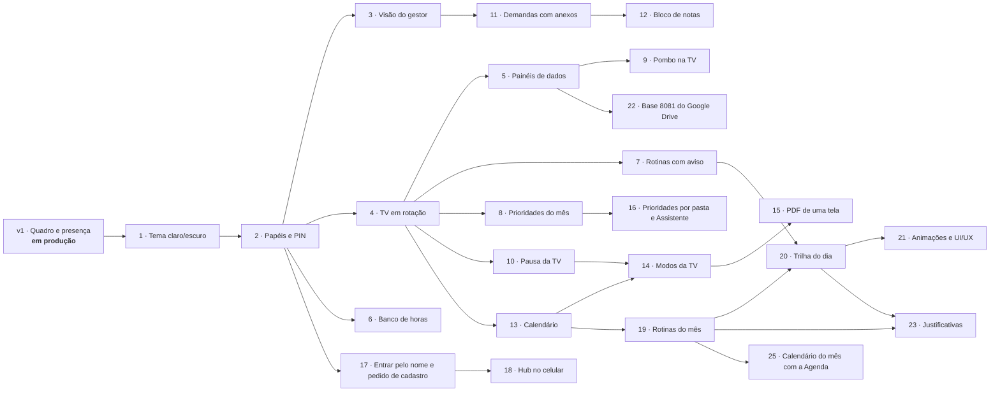

# Roadmap

O Hub é a versão 1 do projeto **API (Analistas da Polybalas Integrados)**. A v1 está em produção desde 20/10/2026. A partir dela, o Hub cresce **uma fase por vez**, cada uma num branch próprio, com testes, documentação e um roteiro de teste manual na empresa.

As fases 19 a 22 são a **v5** (o calendário de rotinas e a trilha do dia do gestor, animações e a 8081 automática do Google Drive): o plano está em [plano-v5.md](plano-v5.md). A fase 17 começa a **v4** (o Hub também no celular). As fases 10 a 16 são a **v3**, com as sugestões do gestor: o plano completo, com as regras e as escolhas de cada fase, está em [plano-v3.md](plano-v3.md).

| Fase | Entrega | Estado |
|---|---|---|
| v1 | Quadro de demandas (A fazer, Fazendo, Concluído hoje), presença e demanda reservada | Em produção |
| 1 | **Tema claro/escuro** no app dos analistas (claro, escuro ou automático, salvo no navegador de cada um). A TV mantém o tema próprio. | Pronto ([roteiro de teste](roteiros/fase-1-tema.md)) |
| 2 | **Papéis e PIN:** analista e gestor, mais a marcação de administrador; entrar com nome + PIN de 4 a 6 dígitos. A TV continua sem login. | Pronto ([roteiro de teste](roteiros/fase-2-pin.md)) |
| 3 | **Visão do gestor:** todas as demandas com filtros, resumo do dia e histórico completo. Abre para o gestor e os administradores. O título de demanda reservada fica só com o gestor, os administradores, o dono e quem criou. | Pronto ([roteiro de teste](roteiros/fase-3-gestor.md)) |
| 4 | **TV em rotação:** a TV alterna entre telas (o Quadro sempre está nela), com tempos configuráveis e telas "plugáveis". Junto vem a **paginação das colunas** (ideia do Kayo): quando uma coluna tem mais demandas do que cabem, ela passa as páginas sozinha com um fade, de tempos em tempos, em vez de esconder o resto em "+ N demandas". A TV continua sem rolar. Primeira tela extra: **Prazos da semana**. | Pronto ([roteiro de teste](roteiros/fase-4-tv.md)) |
| 5 | **Painéis de dados na TV:** as planilhas do time (metas por pasta, fornecedores, produtos foco e a 8081 de vendas) ficam numa pasta só delas e o Hub calcula meta x realizado por pasta. Quatro telas: **Metas do mês**, **Metas do dia**, **Produtos foco** e **Fornecedores das pastas**, só com gráficos e porcentagens (regra do gestor). | Pronto ([roteiro de teste](roteiros/fase-5-paineis.md), [regras](paineis.md)) |
| 6 | **Banco de horas:** o gestor importa o saldo atual que o RH envia e cada analista lança a entrada e a saída do dia (pelo comprovante do ponto) para saber se está com horas extras ou negativas. Só a própria pessoa e o gestor veem; nunca na TV. Não substitui o RH. | Pronto ([roteiro de teste](roteiros/fase-6-banco-de-horas.md)) |
| 7 | **Rotinas com horário e aviso sonoro:** página **Rotinas** (nome, dias, horário, prazo, responsável, pastas e "liberada depois de"). No horário, o cartão aparece sozinho em A fazer do responsável (por cálculo, sem tarefa agendada) e a TV toca um aviso; depois do prazo, fica atrasado. Rotinas sugeridas, as do Kayo: PHD, transferência de pedidos às 14:50 e 16:50 (pastas B, C e F marcam a sua), atualização de positivações no grupo de gestão comercial depois de cada transferência e comparativo de rotas às terças e quintas. | Pronto ([roteiro de teste](roteiros/fase-7-rotinas.md); padrões [em aberto](decisoes.md#em-aberto-o-kayo-confirma)) |
| 8 | **Prioridades do início do mês:** a lista do mês (lançar a meta, confirmar a meta com o gerente, entregar as comissões até o dia 10 e as campanhas até o dia 15, mais o que a equipe acrescentar, com pasta e prazo opcionais), numa tela da rotação que só sai quando tudo estiver feito. Qualquer pessoa marca como feita e fica guardado quem fez; passou do prazo, aparece como atrasada. | Pronto ([roteiro de teste](roteiros/fase-8-prioridades.md), [decisões](decisoes.md#prioridades-do-mês-fase-8)) |
| 9 | **Integração com o [Pombo](https://github.com/fishman2004/pombo):** a tela **Envios do dia** na rotação, lida do histórico CSV que o Pombo de cada analista grava na pasta de rede: uma linha por envio, com horário, analista, canal e a situação (✓ tudo enviado, ⚠ falhas, ⏳ em andamento). A página **Envios** do app mostra os destinatários e o motivo de cada falha. | Pronto ([roteiro de teste](roteiros/fase-9-pombo.md), [como o Hub lê o histórico](arquitetura.md#envios-do-pombo-fase-9)) |
| 10 | **Pausa da TV:** um clique (ou Espaço) na própria TV pausa na tela atual, e as setas trocam de tela e de página. Pelo app, a página **TV da sala** mostra qual tela está na TV agora, pausa a TV da sala numa tela, troca, passa a página do Quadro e retoma; e abre qualquer tela **no meu PC**, parada, sem mexer na sala. Toda pausa volta sozinha (15 min por padrão). | Pronto ([roteiro de teste](roteiros/fase-10-pausa.md)) |
| 11 | **Demandas com descrição e anexos:** campo **Descrição** (no quadro, "📝 Descrição" abre com um clique no cartão), arquivos (Excel, PDF, Word, CSV, imagem, até 25 MB) com **Enviar nova versão** (a anterior fica guardada), **linha do tempo** da demanda (o que mudou, quem e quando), "Anexar o arquivo final?" ao concluir e a página **Demandas**, que busca todas as demandas, inclusive as concluídas há tempo. Arquivos fora do banco, na pasta Anexos; nunca na TV. | Pronto ([roteiro de teste](roteiros/fase-11-anexos.md)) |
| 12 | **Bloco de notas pessoal:** página **Notas** com título, texto (grava sozinho enquanto a pessoa digita), arquivos com nova versão, fixar, arquivar, busca, lixeira de 30 dias, **Transformar em demanda** (levando os arquivos) e **Baixar minhas notas** (ZIP). Só a dona vê: nem gestor nem administrador; fora do histórico e da TV. | Pronto ([roteiro de teste](roteiros/fase-12-notas.md)) |
| 13 | **Calendário:** página **Calendário** (mês, semana e lista) com compromissos (equipe, "só eu" ou reservado; repetição semanal, mensal ou anual), feriados nacionais calculados e os da cidade, ausências da equipe, prazos das demandas, prazos das prioridades e rotinas. Os feriados saem da meta do dia dos painéis, das rotinas e do banco de horas. Na TV, a tela **Agenda** e "Ausente até dd/mm" na faixa de presença. | Pronto ([roteiro de teste](roteiros/fase-13-calendario.md)) |
| 14 | **Modos da TV:** cada modo diz quais telas passam, em que ordem e por quanto tempo, com o som do aviso e os títulos ligados ou não. Vêm prontos o **Padrão** (o que estava em Configurações), **Início de mês** e **Fim de mês** (ligam sozinhos nos 5 primeiros e nos 5 últimos dias úteis) e, sem ligar sozinhos, Fechamento do dia, Hora das transferências, Sábado, Campanha, Reunião na sala, Apresentação dos painéis, Visita e Só o quadro. Qualquer pessoa troca o modo na página **TV da sala**; gestor e administradores criam e editam em **Modos da TV**, com pré-visualização no próprio PC. | Pronto ([roteiro de teste](roteiros/fase-14-modos.md)) |
| 15 | **Exportar a TV em PDF:** na página **TV da sala**, "Exportar PDF" em cada tela, "a tela que está na TV agora" e "todas as telas da rotação" (uma folha por tela, e cada página do Quadro numa folha). Abre a janela de impressão do navegador (**Salvar como PDF**), com a mesma regra da TV, rodapé com data e as iniciais de quem exportou e uma versão clara para imprimir. Fica no histórico. | Pronto ([roteiro de teste](roteiros/fase-15-pdf.md)) |
| 16 | **Prioridades por pasta e o papel Assistente:** cada pessoa é ligada às suas pastas (página **Pessoas**) e marca a prioridade do mês pasta por pasta (quem tem várias escolhe qual concluiu); o item fica feito quando todas as pastas concluíram, e a página e a TV mostram quais pastas já concluíram e quais faltam. Item com **etapas**: as **Metas do mês** (enviar ao gerente, ajustes do gerente com a supervisão, devolução da planilha, upload na 375, 353 e 399) ficam à parte, numa tabela de etapas por pasta. O gestor e os administradores cobrem qualquer pasta. Papel **Assistente** (jovem aprendiz de meio período): pega demandas, tem jornada própria no banco de horas e fica fora das prioridades. | Pronto ([roteiro de teste](roteiros/fase-16-prioridades-por-pasta.md)) |
| 17 | **Entrar pelo nome e pedido de cadastro:** a tela Entrar pede o nome (sem diferença de acento e maiúscula) e o PIN, sem a lista da equipe. Quem não tem cadastro pede pela própria tela, já criando o PIN, e um administrador aprova ou recusa em **Pessoas** (o menu mostra quantos pedidos esperam). Limite de erros por aparelho, além do bloqueio por nome. Num Hub vazio, o primeiro cadastro vira administrador. | Pronto ([roteiro de teste](roteiros/fase-17-login.md)) |
| 18 | **Hub no celular:** pela **Wi-Fi da empresa**, sem internet. No celular, o menu fecha num botão **☰ Menu**, a presença fica em 2×2, tabelas largas rolam de lado e textos compridos quebram a linha. A página **No celular** mostra o endereço do PC da sala e um **QR Code** para apontar a câmera, e o Hub ganha ícone para **Adicionar à tela inicial** (Android e iPhone). | Pronto ([roteiro de teste](roteiros/fase-18-celular.md)) |
| 19 | **Rotinas do mês:** o calendário de rotinas do gestor. Cada rotina tem uma categoria com cor (Acompanhamentos, Metas, Comissionamento, APEX...) e uma regra (dias da semana, N-ésimo dia útil, N-ésimo dia útil antes do fim, dia fixo ou uma data), com os dias calculados sem os feriados. No Calendário, a visão **Rotinas do mês** igual ao modelo, com "feita" no dia de hoje; o cadastro e as categorias para o gestor e os administradores, e as rotinas do modelo com um clique. Na TV, a tela **Rotinas do mês**: o mês inteiro e, depois, um **zoom no dia de hoje**, com o que já foi feito e o próximo dia útil. | Pronto ([roteiro de teste](roteiros/fase-19-rotinas-do-mes.md)) |
| 20 | **Trilha do dia:** os horários de cada analista no dia (como as rotinas semanais do gestor), em blocos com ícone e cor, montados por cada um (ou pelo gestor), com a trilha do modelo e "copiar de outra pessoa". Cada bloco se acende quando é marcado: **verde** no horário, **âmbar** depois e a **luz negativa** vermelha quando o horário passa sem marcar. Um bloco pode ser ligado a uma rotina com aviso e acende sozinho quando o cartão é concluído. No Quadro, a faixa **Minha trilha de hoje**; no menu, **Trilha**, com a equipe e o resumo dos últimos 5 dias úteis. Na TV, a tela **Trilhas do dia**: uma linha por analista no eixo das horas, com uma luz que varre do começo do dia até agora e o bloco de agora por extenso. | Pronto ([roteiro de teste](roteiros/fase-20-trilha.md)) |
| 21 | **Animações e UI/UX:** no app, o menu em 5 grupos (Dia a dia, Planejamento, Dados, TV e celular, Gestão) com Quadro e Trilha à mão, o **Ir para…** (Ctrl+K), a troca de página deslizando, os avisos de sucesso que somem sozinhos, o botão que mostra que está enviando (sem envio duplo), o **quadro vivo** (o cartão que chegou ou mudou brilha; o concluído ganha um ✓), números que contam e barras que crescem. Na TV, a troca de tela com um leve zoom, os itens em cascata, as barras dos painéis crescendo e as porcentagens contando, a demanda concluída comemorando, a presença piscando quando muda e o fundo que anda devagar. Nada disso com "menos movimento" ligado no Windows. | Pronto ([roteiro de teste](roteiros/fase-21-animacoes.md)) |
| 22 | **Base 8081 automática do Google Drive:** a automação do gestor salva a 8081 no Drive e o Hub baixa sozinho, a cada 10 minutos, por uma **ponte do Apps Script** que só entrega o arquivo para quem tem a chave (o arquivo no Drive continua fechado). O Hub confere a planilha antes de trocar a da TV, guarda a hora em que ela foi gerada e mostra em **Painéis** a última verificação, o último download e o último problema, com **Baixar agora**. | Pronto ([roteiro de teste](roteiros/fase-22-drive-8081.md), [passo a passo](drive-8081.md)) |
| 23 | **Justificativas:** marcar feita continua só no dia, mas agora dá para escrever **por que** não deu: nas **rotinas do mês**, hoje ou num dos últimos 31 dias (clicando no número do dia); na **trilha**, no bloco vermelho ou âmbar de hoje. O resumo da trilha conta os justificados. A TV não mostra o texto. | Pronto ([roteiro de teste](roteiros/fase-23-justificativas.md)) |
| 24 | **PHD automático:** quando a 8081 muda, o Hub calcula a positivação de cada vendedor por dia (clientes distintos) e grava uma planilha por pasta, `PHD - Pasta B.xlsx`, no desenho do PHD dos analistas, na pasta de rede escolhida. O Pombo de cada analista lê com o **modelo do PHD** e manda um print com legenda por supervisor no horário. Em **Painéis**: quando gerou, os arquivos para baixar, as áreas de cada supervisor e **Gerar agora**. Nunca na TV. | Pronto ([roteiro de teste](roteiros/fase-24-phd.md), [como funciona](phd.md)) |
| 25 | **Calendário do mês na TV com a Agenda:** a tela do mês com o zoom no dia (fase 19) passa a se chamar **Calendário do mês** e mostra também os **compromissos da equipe** da Agenda, em cinza com a hora, depois das rotinas do mês. Entra na TV com alguma rotina do mês ou algum compromisso no mês (antes, só com rotinas). Compromisso reservado aparece como "Compromisso reservado"; os pessoais nunca. | Pronto ([roteiro de teste](roteiros/fase-25-calendario-tv.md)) |
| 26 | **Vários responsáveis, remover rotina e limpar trilha (pedido do Kayo):** uma rotina pode ter mais de um responsável (o cartão é um só, aparece no quadro de cada um, na TV com as iniciais de todos, e qualquer um conclui). O botão **Remover** tira a rotina da lista, do quadro e da TV (o histórico e as demandas que ela já gerou ficam; só o gestor e os administradores). Na montagem da trilha, **Tirar todos os blocos** limpa a trilha da pessoa de uma vez, com confirmação. | Pronto ([roteiro de teste](roteiros/fase-26-responsaveis-e-remover.md)) |

### Ideias para depois

- **Importar as rotinas do mês de uma planilha**, se os analistas mandarem as demandas num Excel.

- **Modos da TV por pasta** (só a pasta B nos painéis, para a reunião daquela gerência) e com **layout diferente** (por exemplo, a faixa de presença menor).
- **Exportar o calendário** em `.ics` para o Outlook.
- **PDF com valores** (só para o gestor) e **imagem PNG** de uma tela para colar no WhatsApp.

## Regras que valem para todas as fases

- Nada que exija administrador do Windows; atualizar continua sendo extrair o ZIP por cima e rodar `instalar.bat`.
- Mudança no banco é sempre uma migração automática, com cópia antes, que nunca apaga dados.
- A TV nunca rola, mantém a última tela se o servidor cair, não depende de internet e nunca mostra o título de uma demanda reservada.
