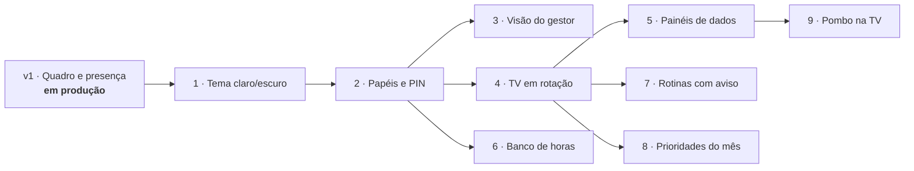

# Roadmap

O Hub é a versão 1 do projeto **API (Analistas da Polybalas Integrados)**. A v1 está em produção desde 20/10/2026. A partir dela, o Hub cresce **uma fase por vez**, cada uma num branch próprio, com testes, documentação e um roteiro de teste manual na empresa.

| Fase | Entrega | Estado |
|---|---|---|
| v1 | Quadro de demandas (A fazer, Fazendo, Concluído hoje), presença e demanda reservada | Em produção |
| 1 | **Tema claro/escuro** no app dos analistas (claro, escuro ou automático, salvo no navegador de cada um). A TV mantém o tema próprio. | Pronto ([roteiro de teste](roteiros/fase-1-tema.md)) |
| 2 | **Papéis e PIN:** analista e gestor, mais a marcação de administrador; entrar com nome + PIN de 4 a 6 dígitos. A TV continua sem login. | A fazer |
| 3 | **Visão do gestor:** todas as demandas com filtros, resumo do dia e histórico completo. Só para gestor. | A fazer |
| 4 | **TV em rotação:** a TV alterna entre telas (o Quadro sempre está nela), com tempos configuráveis e telas "plugáveis". Junto vem a **paginação das colunas** (ideia do Kayo): quando uma coluna tem mais demandas do que cabem, ela passa as páginas sozinha com um fade, de tempos em tempos, em vez de esconder o resto em "+ N demandas". A TV continua sem rolar. | A fazer |
| 5 | **Painéis de dados na TV:** atendimento, pastas destaque, venda e positivação, lidos de arquivos CSV/XLSX que os analistas exportam. O Hub só exibe, não calcula. | A fazer |
| 6 | **Banco de horas:** saldo inicial da planilha base e lançamento manual de entrada e saída do dia anterior. Só a própria pessoa e o gestor veem; nunca na TV. | A fazer |
| 7 | **Rotinas com horário e aviso sonoro:** transferência de pedidos às 15h e 17h (cada pasta marca a sua; relatório de rotas liberado só depois de todas), positivações diárias e comparativo de rotas às terças e quintas. A demanda da rotina aparece por cálculo no horário. | A fazer |
| 8 | **Prioridades do início do mês:** meta, fechamentos, novos acompanhamentos por pasta e apuração de campanhas, numa tela da rotação que só sai quando tudo estiver feito. | A fazer |
| 9 | **Integração com o [Pombo](https://github.com/fishman2004/pombo):** os envios do dia como uma tela da rotação, lidos do histórico CSV que o Pombo grava na pasta de rede. | A fazer |

## Regras que valem para todas as fases

- Nada que exija administrador do Windows; atualizar continua sendo extrair o ZIP por cima e rodar `instalar.bat`.
- Mudança no banco é sempre uma migração automática, com cópia antes, que nunca apaga dados.
- A TV nunca rola, mantém a última tela se o servidor cair, não depende de internet e nunca mostra o título de uma demanda reservada.
