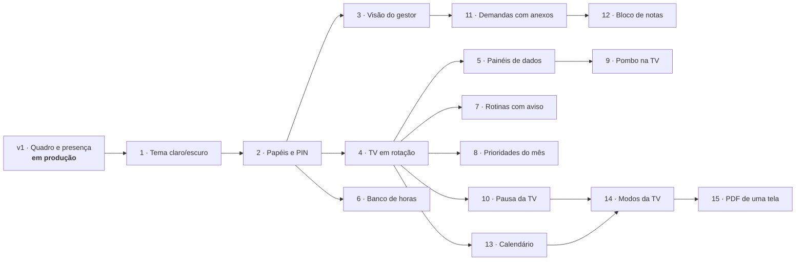

# Roadmap

O Hub é a versão 1 do projeto **API (Analistas da Polybalas Integrados)**. A v1 está em produção desde 20/10/2026. A partir dela, o Hub cresce **uma fase por vez**, cada uma num branch próprio, com testes, documentação e um roteiro de teste manual na empresa.

As fases 10 a 15 são a **v3**, com as sugestões do gestor: o plano completo, com as regras e as escolhas de cada fase, está em [plano-v3.md](plano-v3.md).

| Fase | Entrega | Estado |
|---|---|---|
| v1 | Quadro de demandas (A fazer, Fazendo, Concluído hoje), presença e demanda reservada | Em produção |
| 1 | **Tema claro/escuro** no app dos analistas (claro, escuro ou automático, salvo no navegador de cada um). A TV mantém o tema próprio. | Pronto ([roteiro de teste](roteiros/fase-1-tema.md)) |
| 2 | **Papéis e PIN:** analista e gestor, mais a marcação de administrador; entrar com nome + PIN de 4 a 6 dígitos. A TV continua sem login. | Pronto ([roteiro de teste](roteiros/fase-2-pin.md)) |
| 3 | **Visão do gestor:** todas as demandas com filtros, resumo do dia e histórico completo. Abre para o gestor e os administradores. O título de demanda reservada fica só com o gestor, os administradores, o dono e quem criou. | Pronto ([roteiro de teste](roteiros/fase-3-gestor.md)) |
| 4 | **TV em rotação:** a TV alterna entre telas (o Quadro sempre está nela), com tempos configuráveis e telas "plugáveis". Junto vem a **paginação das colunas** (ideia do Kayo): quando uma coluna tem mais demandas do que cabem, ela passa as páginas sozinha com um fade, de tempos em tempos, em vez de esconder o resto em "+ N demandas". A TV continua sem rolar. Primeira tela extra: **Prazos da semana**. | Pronto ([roteiro de teste](roteiros/fase-4-tv.md)) |
| 5 | **Painéis de dados na TV:** as planilhas do time (metas por pasta, fornecedores, produtos foco e a 8081 de vendas) ficam numa pasta só delas e o Hub calcula meta x realizado por pasta. Quatro telas: **Metas do mês**, **Metas do dia**, **Produtos foco** e **Fornecedores das pastas**, só com gráficos e porcentagens (regra do gestor). | Pronto ([roteiro de teste](roteiros/fase-5-paineis.md), [regras](paineis.md)) |
| 6 | **Banco de horas:** o gestor importa o saldo atual que o RH envia e cada analista lança a entrada e a saída do dia (pelo comprovante do ponto) para saber se está com horas extras ou negativas. Só a própria pessoa e o gestor veem; nunca na TV. Não substitui o RH. | Pronto ([roteiro de teste](roteiros/fase-6-banco-de-horas.md)) |
| 7 | **Rotinas com horário e aviso sonoro:** página **Rotinas** (nome, dias, horário, prazo, responsável, pastas e "liberada depois de"). No horário, o cartão aparece sozinho em A fazer do responsável (por cálculo, sem tarefa agendada) e a TV toca um aviso; depois do prazo, fica atrasado. Rotinas sugeridas, as do Kayo: PHD, transferência de pedidos às 14:50 e 16:50 (pastas B, C e F marcam a sua), atualização de positivações no grupo de gestão comercial depois de cada transferência e comparativo de rotas às terças e quintas. | Pronto ([roteiro de teste](roteiros/fase-7-rotinas.md); padrões [em aberto](decisoes.md#em-aberto-o-kayo-confirma)) |
| 8 | **Prioridades do início do mês:** a lista do mês (lançar a meta, confirmar a meta com o gerente, entregar as comissões até o dia 10 e as campanhas até o dia 15, mais o que a equipe acrescentar, com pasta e prazo opcionais), numa tela da rotação que só sai quando tudo estiver feito. Qualquer pessoa marca como feita e fica guardado quem fez; passou do prazo, aparece como atrasada. | Pronto ([roteiro de teste](roteiros/fase-8-prioridades.md), [decisões](decisoes.md#prioridades-do-mês-fase-8)) |
| 9 | **Integração com o [Pombo](https://github.com/fishman2004/pombo):** a tela **Envios do dia** na rotação, lida do histórico CSV que o Pombo de cada analista grava na pasta de rede: uma linha por envio, com horário, analista, canal e a situação (✓ tudo enviado, ⚠ falhas, ⏳ em andamento). A página **Envios** do app mostra os destinatários e o motivo de cada falha. | Pronto ([roteiro de teste](roteiros/fase-9-pombo.md), [como o Hub lê o histórico](arquitetura.md#envios-do-pombo-fase-9)) |
| 10 | **Pausa da TV:** um clique (ou Espaço) na própria TV pausa na tela atual, e as setas trocam de tela e de página. Pelo app, a página **TV da sala** mostra qual tela está na TV agora, pausa a TV da sala numa tela, troca, passa a página do Quadro e retoma; e abre qualquer tela **no meu PC**, parada, sem mexer na sala. Toda pausa volta sozinha (15 min por padrão). | Pronto ([roteiro de teste](roteiros/fase-10-pausa.md)) |
| 11 | **Demandas com descrição e anexos:** campo **Descrição** (no quadro, "📝 Descrição" abre com um clique no cartão), arquivos (Excel, PDF, Word, CSV, imagem, até 25 MB) com **Enviar nova versão** (a anterior fica guardada), **linha do tempo** da demanda (o que mudou, quem e quando), "Anexar o arquivo final?" ao concluir e a página **Demandas**, que busca todas as demandas, inclusive as concluídas há tempo. Arquivos fora do banco, na pasta Anexos; nunca na TV. | Pronto ([roteiro de teste](roteiros/fase-11-anexos.md)) |
| 12 | **Bloco de notas pessoal** com anexos (só a dona vê) | Planejada |
| 13 | **Calendário:** compromissos, feriados, ausências, prazos e rotinas num lugar, e a tela **Agenda** na TV | Planejada |
| 14 | **Modos da TV:** Início de mês, Fim de mês e outros, automáticos ou à mão, e criar modos | Planejada |
| 15 | **Exportar uma tela da TV em PDF**, com a mesma regra da TV | Planejada |

## Regras que valem para todas as fases

- Nada que exija administrador do Windows; atualizar continua sendo extrair o ZIP por cima e rodar `instalar.bat`.
- Mudança no banco é sempre uma migração automática, com cópia antes, que nunca apaga dados.
- A TV nunca rola, mantém a última tela se o servidor cair, não depende de internet e nunca mostra o título de uma demanda reservada.
